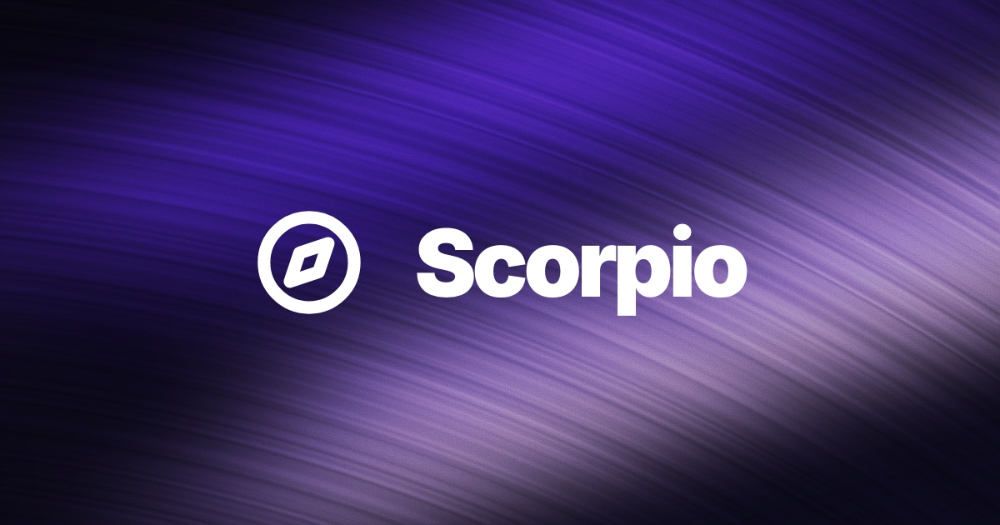
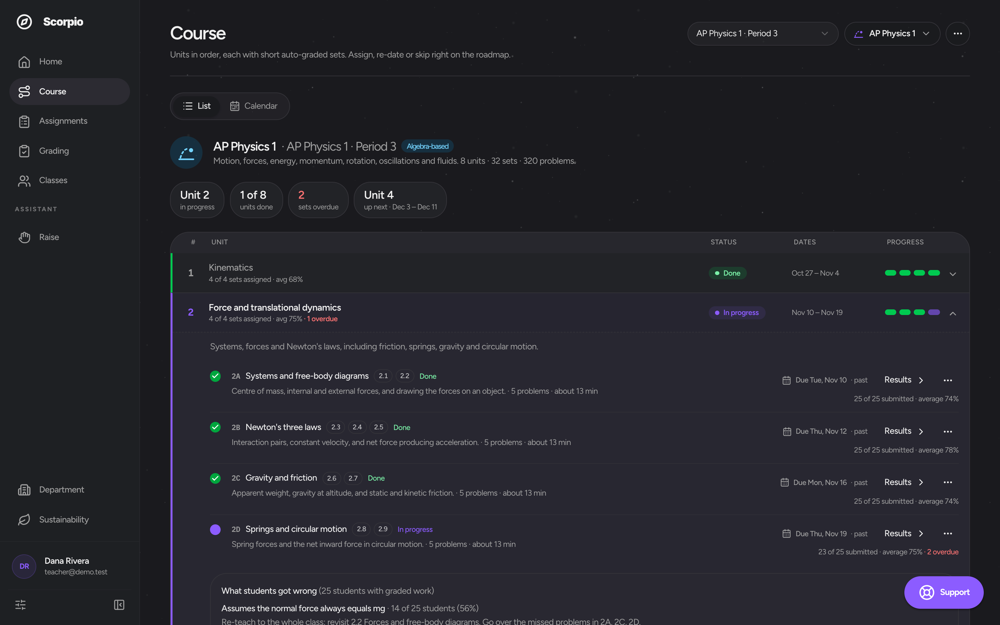
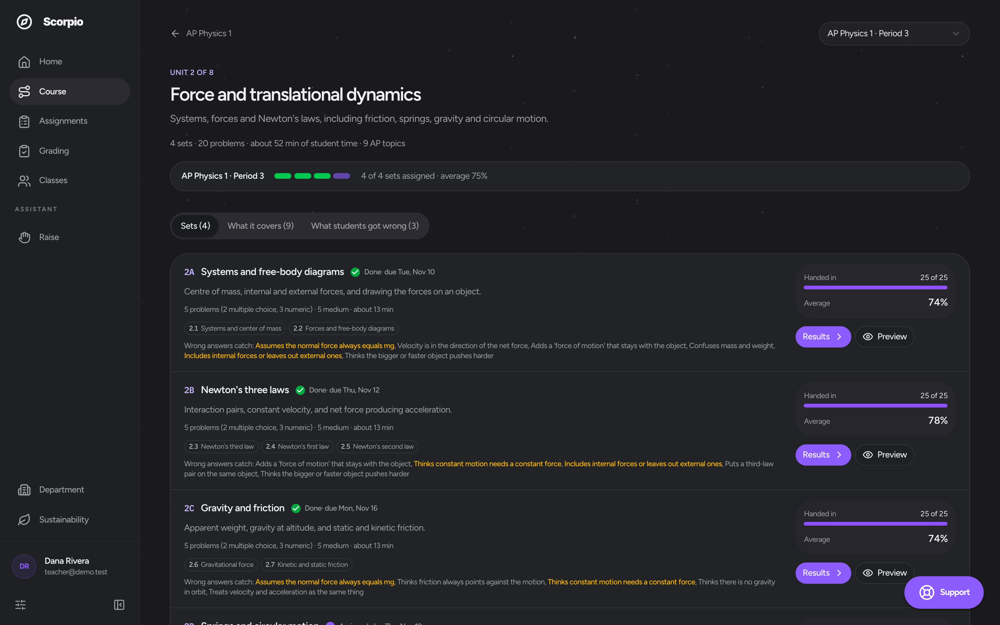
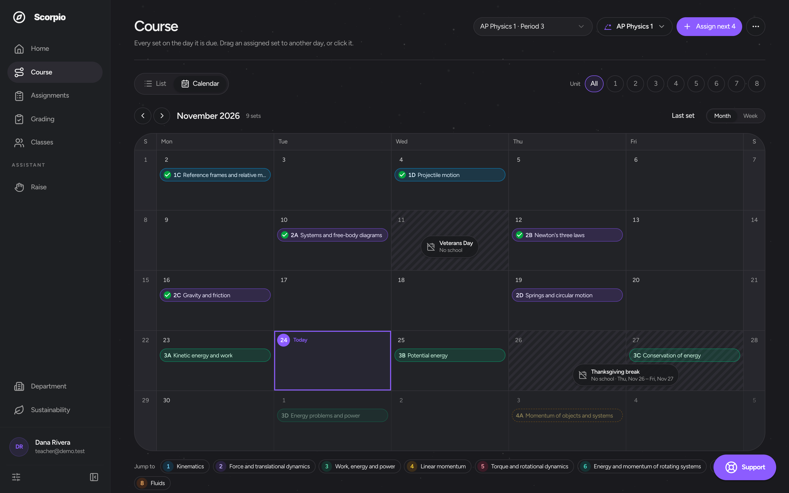
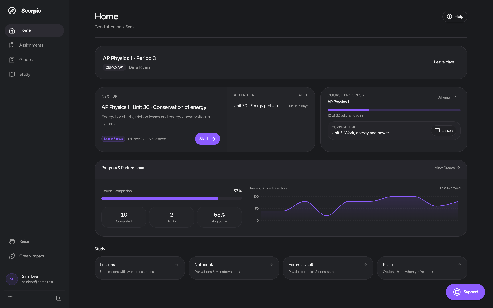
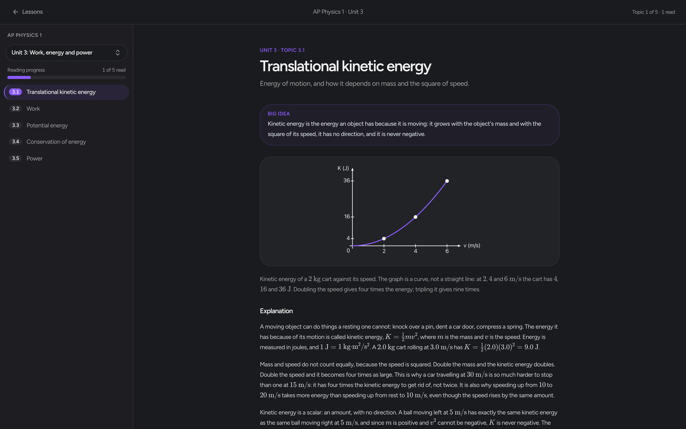
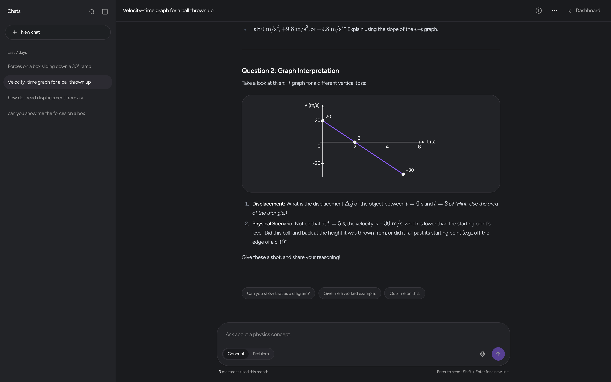
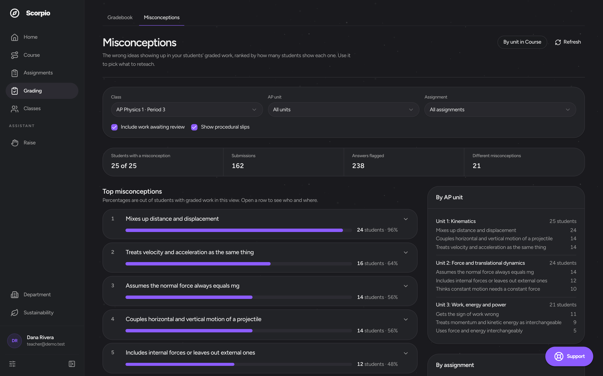
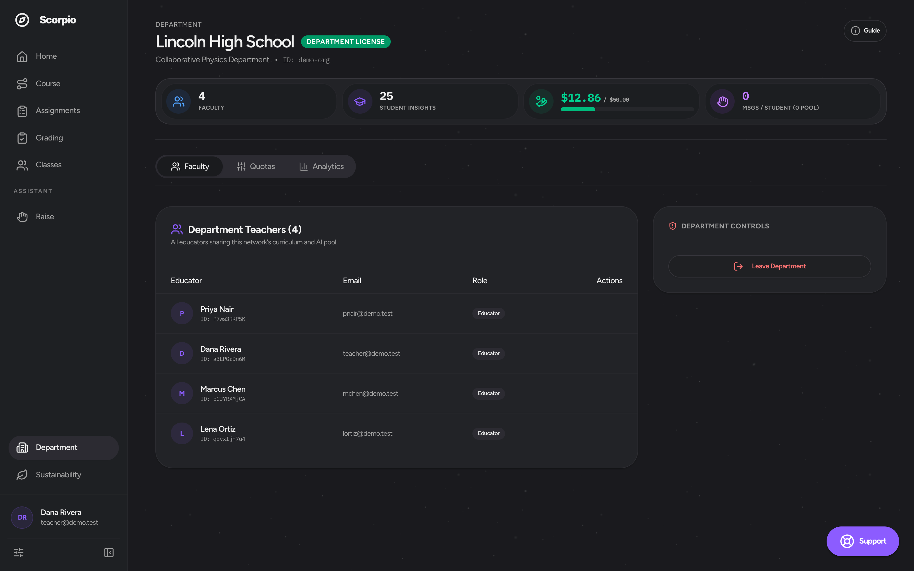
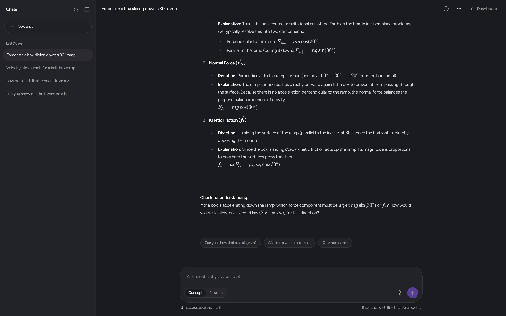

# Scorpio

[](https://nextjs.org/)
[](https://www.typescriptlang.org/)
[](https://tailwindcss.com/)
[](https://firebase.google.com/)
[](https://deepmind.google/technologies/gemini/)
[](https://polar.sh/)



> **Empower thinking. Stop AI solvers.**

Scorpio is a homework and classroom platform for AP Physics. It has three parts that work together:

- **Courses.** Ordered, unit-by-unit roadmaps of ready-made problem sets that a teacher can follow, pace and adjust for each class.
- **Raise.** A Socratic AI assistant that gives students hints instead of answers, so homework still reflects what they understand.
- **Grading and insight.** Automatic grading of numeric and multiple-choice work, and a class report that ranks the misconceptions students are showing.

Scorpio supports four courses: AP Physics 1, AP Physics 2, AP Physics C: Mechanics, and AP Physics C: Electricity and Magnetism.

---

## Contents

1. [Courses](#courses)
2. [Raise, the AI assistant](#raise-the-ai-assistant)
3. [Grading and the misconception report](#grading-and-the-misconception-report)
4. [Other capabilities](#other-capabilities)
5. [Architecture](#architecture)
6. [Research and evaluation](#research-and-evaluation)
7. [Project structure](#project-structure)
8. [Technology stack](#technology-stack)
9. [Getting started](#getting-started)
10. [Quality assurance](#quality-assurance)
11. [Deployment](#deployment)
12. [Further documentation](#further-documentation)

---

## Courses

Scorpio separates two ideas that are easy to confuse:

- **Waypoints** are the library of individual assignments, grouped as global, department and personal sets.
- **Courses** are ordered roadmaps built on top of that library. A course lists its units in sequence, and each unit lists its sets in sequence.

A teacher can attach a course to a class. Classes that follow no course behave exactly as they did before.

### Available courses

| Course                                  | Units | Sets | Problems |
| :-------------------------------------- | ----: | ---: | -------: |
| AP Physics 1                            |     8 |   32 |      320 |
| AP Physics 2                            |     7 |   28 |      280 |
| AP Physics C: Mechanics                 |     7 |   28 |      280 |
| AP Physics C: Electricity and Magnetism |     6 |   24 |      240 |

Each set contains ten problems. Problems are drafted with AI assistance, validated automatically, independently re-solved by a second model call, and then reviewed before publication. Review of answer keys is ongoing, and review logs are kept in `content/`. A course whose sets contain no problems is shown as planned and cannot be assigned.

### What a teacher can do

The Courses page (`/teacher/courses`) is organized around one class at a time.



- **Roadmap.** Units appear in the class's order. Each set shows its description, problem count, estimated time, status, and, once assigned, how many students have submitted and the class average. A preview shows the problems as students see them, along with the topics covered and the misconceptions the wrong answers are designed to catch.
- **Assign in bulk.** One dialog copies a whole unit into the class with staggered due dates. It lists exactly what will be created before anything is saved, and skips sets the class already has.
- **Pacing.** A pacing guide dates every remaining set, projects a finish date at the current pace, and warns when the course would run into the AP exam window. Due dates can be moved in bulk, by unit or across the whole class.
- **School calendar.** Due dates skip weekends and the class's days off. US school holidays are the default, and each class can edit its own calendar.
- **Customization.** A class can reorder units, reorder sets within a unit, and skip sets entirely, without altering the underlying course.
- **Unit guides.** Each unit has a page covering its sets, topics, question types, difficulty mix and targeted misconceptions. With a class selected, it also shows that class's results.
- **Re-teach suggestions.** When a misconception is widespread in a unit, the page recommends a response: re-teach to the whole class, pull a small group, or check in individually. These suggestions are rule-based, so the same data always produces the same advice.

| Unit guide | Calendar view |
| :-: | :-: |
|  |  |

### What a student sees

The student dashboard shows a roadmap card with progress through each unit, the student's own average, and the next assignment due. The assignments page groups work under unit headings in the order the class is following.

| Student home | Lesson reader |
| :-: | :-: |
|  |  |

For the data model, API routes and admin publishing workflow, see [docs/courses.md](docs/courses.md).

---

## Raise, the AI assistant

Raise is Scorpio's physics tutor. It is a context-aware assistant, not a general chatbot: it declines off-topic requests, explains concepts directly, and guides numerical problem solving with questions instead of solutions. Within an assignment it is limited to short, strictly pedagogical hints.



### The four-layer constraint system

Raise's behavior is composed from four layers, each with a single responsibility. The layers are published in this repository so that educators and researchers can inspect them. Model errors and direct-answer leakage remain possible and require ongoing evaluation.

| Layer  | Constraint      | Purpose                                                           |
| :----- | :-------------- | :---------------------------------------------------------------- |
| **01** | **Domain**      | Restricts knowledge to physics and refuses unrelated requests.    |
| **02** | **Pedagogical** | Classifies student intent and selects how much scaffolding to use. |
| **03** | **Notation**    | Requires correct LaTeX, vector notation and units.                |
| **04** | **Socratic**    | Elicits student reasoning through guiding questions.              |

Further reading:

- [System architecture (PDF)](./public/architecture.pdf)
- [Prompt layering diagram (PDF)](./public/layering.pdf)
- [Prompt layering notes (Markdown)](LAYERING.MD)

The assistant was previously named Tutor. Some older documents refer to it by an earlier working name.

---

## Grading and the misconception report

### Grading

One grading core, shared by the submit-time Cloud Function and the teacher's grade button, applies deterministic checks first and uses AI only for written answers.

- **Numeric answers** are checked for value, unit and tolerance. Equivalent units are converted, rounded answers within tolerance pass, and common slips such as sign errors and powers of ten are identified by name.
- **Multiple choice and true/false** are matched exactly.
- **Free response** is graded by AI against the expected answer and the teacher's rubric. Answers that look like prompt injection, or that the grader cannot assess confidently, are routed to the teacher for review instead of receiving a grade.

On a labelled set of 50 AP Physics 1 answers, the shared grading core placed 99.3% of scores in the band a teacher would accept. See [docs/grading.md](docs/grading.md).

### Class misconception report

Each graded answer carries tags for the misconceptions it reveals. The report at `/teacher/insights` ranks them by the number of students affected, for example "8 of 24 students", and breaks them down by class, assignment and AP unit. It is available on every plan.



---

## Other capabilities

### Teacher network

The network dashboard at `/teacher/network` supports organization-level work: shared department Waypoints, AI-assisted student portfolios, and administrative oversight.



- **Department sharing.** Waypoints can be shared across a school network.
- **Onboarding.** Teacher invite codes support attributed, controlled registration.
- **Usage analytics.** Token consumption and AI spend are tracked per organization, with a spend cap.

### Mathematical rendering



- **Visual math builder.** Equations can be constructed without writing raw LaTeX.
- **KaTeX rendering.** Fast client-side typesetting for all physics expressions.

### Plans

Every global Waypoint, including all published AP Physics 1 sets, automatic grading and the misconception report are free. A paid Department License adds department Waypoints and sharing, and higher AI limits.

### Interface

The interface uses a restrained space theme. Motion is built with `framer-motion`, and surfaces are built on **Radix UI** primitives and **Tailwind CSS v4**.

---

## Architecture

Scorpio is built around real-time synchronization, strict typing and a clear separation between the client, the AI layer and managed backend services.

### System data flow


### Data and AI infrastructure

- **Modular AI core.** Separate engines in `src/lib/ai/` handle tutoring, grading, notebook assistance, research and the student-portfolio network.
- **Real-time synchronization.** Cloud Firestore listeners and optimistic UI updates keep teacher and student views current without manual refresh.
- **Background orchestration.** Firebase Cloud Functions run automated grading, Polar subscription management and Resend email templates.

---

## Research and evaluation

Scorpio includes a research dashboard for monitoring how well the constraint architecture performs. It tracks:

- **Rule adherence.** How often the tutor maintains Socratic constraints.
- **Response quality.** Automated evaluation of pedagogical relevance and clarity.
- **Token efficiency.** Prompt length relative to output quality, as a proxy for latency and cost.

> **Note.** Early results indicate that the full constraint stack outperforms an unconstrained model on educational utility across several difficulty levels. These results are preliminary and should not be read as a claim of classroom efficacy.

---

## Project structure

```text
├── src/
│   ├── app/            # Next.js App Router (student, teacher and network dashboards)
│   ├── components/     # Reusable UI (shadcn/ui and custom math components)
│   ├── contexts/       # Global state (auth, space effects, appearance)
│   ├── hooks/          # Custom React hooks (mobile, sidebar, window state)
│   ├── lib/            # Core logic (AI core, Firebase, Polar, usage limits)
│   └── proxy.ts        # Edge routing and middleware logic
├── tools/              # Administrative operations (school security migration)
├── public/             # Static assets (models, architecture PDFs, demos)
├── functions/          # Firebase Cloud Functions (grading, emails, portfolios)
└── firestore.rules     # Database security rules
```

---

## Technology stack

| Layer            | Technology                                                       | Purpose                                           |
| :--------------- | :--------------------------------------------------------------- | :------------------------------------------------ |
| **Frontend**     | [Next.js 16](https://nextjs.org/)                                | Server components, streaming and routing          |
| **Language**     | [TypeScript 5.9](https://www.typescriptlang.org/)                | Strict type safety                                |
| **Styling**      | [Tailwind CSS 4.0](https://tailwindcss.com/)                     | Utility-first styling                             |
| **UI library**   | [shadcn/ui](https://ui.shadcn.com/)                              | Accessible component primitives                   |
| **Billing**      | [Polar.sh](https://polar.sh/)                                    | Subscriptions and billing                         |
| **Motion**       | [Framer Motion](https://www.framer.com/motion/)                  | Animation and gesture handling                    |
| **Backend**      | [Firebase 12](https://firebase.google.com/)                      | Auth, Firestore, Functions and Storage            |
| **AI model**     | [Gemini 3.8 Flash](https://deepmind.google/technologies/gemini/) | Multimodal reasoning and constraint adherence     |

---

## Getting started

### Prerequisites

- **Node.js 22**, the version pinned in `.nvmrc`. `functions/` requires exactly Node 22. With nvm: `nvm install && nvm use`.
- **npm 11 or newer.** `package-lock.json` is generated by npm 11. Node 22 ships npm 10, which prints an engine warning (`engines.npm >=11`) and may not reproduce the lockfile exactly. Run `npm install -g npm@11` once after `nvm use`.
- **Java 17 or newer** and `firebase-tools` (`npm install -g firebase-tools`) for the Firebase emulators and `npm run test:security`.

### Installation

1. **Clone and install.** The root and `functions/` have separate lockfiles, and both are required; otherwise `npm run typecheck` fails with TS2307 in `functions/`.

   ```bash
   git clone https://github.com/RushilMahadevu/scorpio.git
   cd scorpio
   nvm install && nvm use
   npm install -g npm@11
   npm ci
   npm ci --prefix functions   # or run both with: npm run setup
   ```

   `npm ci` also installs the git pre-commit hook (husky and lint-staged, running `eslint --fix` and `prettier --write` on staged files). The hook is skipped when `CI` is set, outside a git checkout, and with `--omit=dev`.

2. **Configure the environment.**

   ```bash
   cp .env.example .env.local
   ```

   `.env.example` lists every variable the app reads, with comments. Fill in values in `.env.local`, which is git-ignored. To develop without real services, use the demo values in [`docs/quality-audit/remediation/EMULATOR-DEV.md`](docs/quality-audit/remediation/EMULATOR-DEV.md). Server-side features validate their variables on first use (`src/lib/env.ts`) and report missing variable names, never values.

3. **Run against local emulators.** No production access is required.

   ```bash
   npm run dev:emulators        # Auth 9099, Firestore 8080, Storage 9199, UI 4001
   npm run dev:emulators:alt    # same, on 19099 / 18080 / 19199 / 14001 if the defaults are taken
   npm run dev                  # in a second terminal
   ```

   Gemini, Polar billing and Resend email are not emulated. See EMULATOR-DEV.md for the `.env.local` values and the alternate-port variables.

---

## Quality assurance

| Command                                      | Description                                                                                                                                         |
| :------------------------------------------- | :-------------------------------------------------------------------------------------------------------------------------------------------------- |
| `npm run typecheck`                          | `tsc --noEmit` for the app and for `functions/`.                                                                                                    |
| `npm run lint`                               | ESLint. Existing findings are tracked in `docs/quality-audit/remediation/baseline-counts.json`; new findings should not be introduced.              |
| `npm test` / `npm run test:ci`               | Jest unit tests.                                                                                                                                    |
| `npm run test:security`                      | Firestore and Storage rules tests in the emulator (requires Java).                                                                                  |
| `bash docs/quality-audit/remediation/gate.sh` | Full regression gate: typecheck, Jest, security suite, ESLint ceilings and `next build`.                                                            |

### Continuous integration

Every pull request and every push to `main` runs `.github/workflows/ci.yml`. The workflow performs a typecheck, ESLint (non-blocking until the baseline is cleared), Jest, the Firebase-emulator security suite, `next build`, `npm audit` (non-blocking for now) and a gitleaks secret scan. CI installs npm 11 and runs `npm ci` in both the root and `functions/`.

---

## Deployment

The web application is deployed on Vercel from `main`. Firestore rules, Storage rules and Cloud Functions are deployed to Firebase. When a change touches several of these, deploy in this order: security rules, then the web application, then functions.

```bash
firebase deploy --only firestore:rules,storage
firebase deploy --only functions
```

Production configuration is held in the Vercel and Firebase project settings, not in the repository. The deployment target is still under review; see [RT-33-DEPLOY-PATHS.md](docs/quality-audit/remediation/RT-33-DEPLOY-PATHS.md).

---

## Further documentation

| Document                                                             | Subject                                                      |
| :------------------------------------------------------------------- | :----------------------------------------------------------- |
| [docs/courses.md](docs/courses.md)                                   | Courses: data model, routes, pacing, publishing.             |
| [docs/grading.md](docs/grading.md)                                   | Grading rules and accuracy evaluation.                       |
| [docs/content-pipeline.md](docs/content-pipeline.md)                 | Problem drafting and review, and misconception tagging.      |
| [docs/onboarding.md](docs/onboarding.md)                             | Teacher invite codes and first-run setup.                    |
| [docs/school-deployment-readiness.md](docs/school-deployment-readiness.md) | Review before applying the security migration or onboarding students. |

---

Released under the [MIT License](LICENSE). &copy; 2026 Scorpio.
