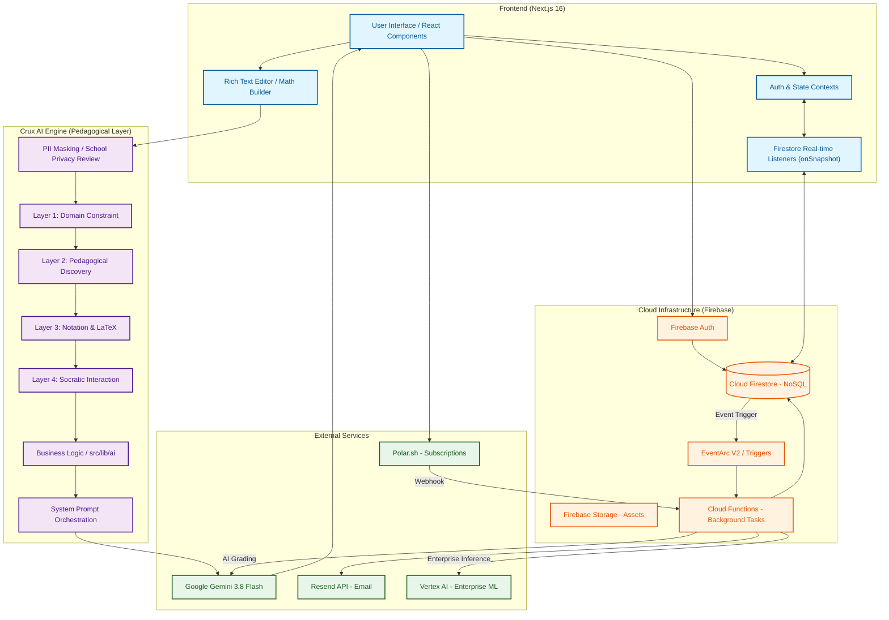

#  Scorpio

[](https://nextjs.org/)
[](https://www.typescriptlang.org/)
[](https://tailwindcss.com/)
[](https://firebase.google.com/)
[](https://deepmind.google/technologies/gemini/)
[](https://polar.sh/)


> **Empower Thinking. Stop AI Solvers.**

Scorpio is a Socratic AI platform built to empower the physics classroom. By integrating a novel **4-layer AI constraint architecture** through its specialized pedagogical AI, **Crux**, with a high-performance, space-themed interface, Scorpio bridges the gap between traditional teacher tools and the dynamic cognitive requirements of physics problem-solving.

---

## 🏗️ Technical Architecture

Scorpio's architecture is built for concurrency, type safety, and real-time synchronization.
 
### 🔄 System Data Flow


### 🛡️ The 4-Layer Constraint System
At the heart of Crux's AI tutoring capabilities is a **transparent and research-driven** constraint architecture designed to support pedagogical validity and academic integrity. Model errors and direct-answer leakage remain possible and require ongoing evaluation.

[**📄 View Full System Architecture (PDF)**](./public/architecture.pdf)

> [!IMPORTANT]
> The system enforces strict pedagogical adherence through four distinct, open-source layers:

| Layer  | Constraint      | Purpose                                                      |
| :----- | :-------------- | :----------------------------------------------------------- |
| **01** | **Domain**      | Restricts knowledge exclusively to physics principles.       |
| **02** | **Pedagogical** | Enforces the Socratic method; direct answers are prohibited. |
| **03** | **Notation**    | Mandates proper LaTeX formatting and SI unit adherence.      |
| **04** | **Composite**   | Synchronizes all layers for research-grade tutoring.         |

#### Prompt Layering
[**📦 View Prompt Layering Diagram (PDF)**](./public/layering.pdf) |
[**📦 View Prompt Layering Diagram (MD)**](LAYERING.md)

### 🔄 Data & AI Infrastructure
- **Modular AI Core:** Specialized `src/lib/ai/` engines for **Tutor**, **Grading**, **Notebook**, **Research**, and **Network** (Student Portfolios).
- **Real-Time Synchronization:** Powered by **Cloud Firestore** with optimistic UI updates for zero-latency interaction.
- **Background Orchestration:** Firebase Cloud Functions handle automated grading, **Polar** subscriber management, and **Resend** email templates.

### 🛡️ Administrative Oversight Tools
Scorpio includes a robust management layer for educators and administrators:
- **AI Cost & Usage Analytics:** Detailed tracking of token consumption and Gemini API overhead.
- **Onboarding Management:** Teacher invite codes and registration workflow control.
- **Global Engagement Data:** Distribution charts and high-level classroom analytics.

---

## 🚀 Core Capabilities

### 🎓 Research-Grade AI Tutoring

Crux is a **context-aware pedagogical agent**, not a generic chatbot. Its reasoning logic is fully open-source and peer-reviewable.
- **Multi-Modal Assistants:** Context-specific helpers including a **Notebook Assistant**, **Landing Chatbot**, and **Navigation Assistant**.
- **Transparent Pedagogy:** Our prompt engineering and constraint layers are public to ensure academic trust.
- **Academic Integrity:** Hardened against jailbreak attempts and direct-answer harvesting.

### 📡 Teacher "Network" Control Center

A high-scale classroom management dashboard (`/teacher/network`) designed for:
- **Real-Time Monitoring:** Track student progress and aggregate analytics across multiple sections.
- **Automated Insights:** Generate student portfolios and identify learning gaps through AI-driven audit logs.

### 🔢 Advanced Mathematical Rendering

Precision is non-negotiable in physics. Our custom rendering engine includes:
- **Visual Math Builder:** An intuitive UI for constructing complex equations without raw LaTeX knowledge.
- **KaTeX Integration:** Blazing fast client-side LaTeX rendering for all physics expressions.

### 🌌 Immersive User Experience
A "Space-Themed" aesthetic designed to reduce cognitive load and boost engagement.
- **Physics-Based Motion:** Smooth transitions and parallax effects powered by `framer-motion`.
- **Glassmorphism:** Context-aware `backdrop-blur` interfaces using **Radix UI** primitives and **Tailwind CSS v4**.

---

## 🔬 Research & Efficacy

Scorpio includes a dedicated research dashboard to monitor the performance of its AI architecture. System metrics track:

- **Rule Adherence %**: The frequency with which the AI successfully maintains Socratic constraints.
- **Response Quality**: Automated evaluation of pedagogical relevance and clarity.
- **Token Efficiency**: Optimization of prompt length versus output quality to reduce latency.

> [!TIP]
> **Data Insight:** *Experimental results indicate that the Full Constraint Stack significantly outperforms standard models in educational utility, maintaining a high quality score across varying difficulty levels.*

---

## 📂 Project Structure

```text
├── src/
│   ├── app/            # Next.js App Router (Student, Teacher, & Network Dashboards)
│   ├── components/     # Reusable UI (Shadcn + Custom Math Components)
│   ├── contexts/       # Global State (Auth, Space Effects, Appearance)
│   ├── hooks/          # Custom React Hooks (Mobile, Sidebar, Window State)
│   ├── lib/            # Core Logic (AI Core, Firebase, Polar, Usage Limits)
│   └── proxy.ts        # Edge routing & middleware logic
├── tools/              # Admin ops (school security migration)
├── public/             # Static Assets (Models, Architecture PDFs, Demos)
├── functions/          # Firebase Cloud Functions (Grading, Emails, Portfolios)
└── firestore.rules     # Database Security Layers
```

---

## 🛠️ Technology Stack

| Layer          | Technology                                                       | Purpose                                                |
| :------------- | :--------------------------------------------------------------- | :----------------------------------------------------- |
| **Frontend**   | [Next.js 16](https://nextjs.org/)                                | Server Components, Streaming, and Routing              |
| **Language**   | [TypeScript 5.9](https://www.typescriptlang.org/)                | Strict type safety and developer ergonomics            |
| **Styling**    | [Tailwind CSS 4.0](https://tailwindcss.com/)                     | Next-gen utility styling with modern CSS features      |
| **UI Library** | [Shadcn UI](https://ui.shadcn.com/)                              | Accessible, headless component primitives              |
| **Monetization**| [Polar.sh](https://polar.sh/)                                   | Developer-first subscriptions and billing              |
| **Motion**     | [Framer Motion](https://www.framer.com/motion/)                  | Physics-based animations and gesture handling          |
| **Backend**    | [Firebase 12](https://firebase.google.com/)                      | Auth, Firestore (NoSQL), Functions, Storage            |
| **AI Model**   | [Gemini 3.8 Flash](https://deepmind.google/technologies/gemini/) | Multimodal reasoning and constraint adherence          |

---

## ⚡ Quick Start

### 📝 Prerequisites
- **Node.js 22** (the version in `.nvmrc`; `functions/` requires exactly 22). With nvm: `nvm install && nvm use`.
- **npm 11 or newer.** `package-lock.json` is generated by npm 11; Node 22 ships npm 10, which prints an engine warning (`engines.npm >=11`) and may not reproduce the lockfile exactly. Run `npm install -g npm@11` once after `nvm use`.
- **Java 17+** and `firebase-tools` (`npm install -g firebase-tools`) for the Firebase emulators and `npm run test:security`.

### 🛠️ Installation & Setup

1. **Clone & install** (root and `functions/` have separate lockfiles; both are required, otherwise `npm run typecheck` fails with TS2307 in `functions/`):
   ```bash
   git clone https://github.com/RushilMahadevu/scorpio.git
   cd scorpio
   nvm install && nvm use
   npm install -g npm@11
   npm ci
   npm ci --prefix functions   # or run both with: npm run setup
   ```
   `npm ci` also installs the git pre-commit hook (husky + lint-staged: `eslint --fix` and `prettier --write` on staged files). It is skipped when `CI` is set, outside a git checkout, and with `--omit=dev`.

2. **Environment**
   ```bash
   cp .env.example .env.local
   ```
   `.env.example` lists every variable name the app reads, with comments. Fill in values in `.env.local` (git-ignored). To develop with no real services, use the demo values in [`docs/quality-audit/remediation/EMULATOR-DEV.md`](docs/quality-audit/remediation/EMULATOR-DEV.md).
   Server-side features validate their variables on first use (`src/lib/env.ts`) and report the missing variable *names*, never values.

3. **Run against local emulators (no production access needed)**
   ```bash
   npm run dev:emulators        # Auth 9099, Firestore 8080, Storage 9199, UI 4001
   npm run dev:emulators:alt    # same, on 19099 / 18080 / 19199 / 14001 if the defaults are taken
   npm run dev                  # in another terminal
   ```
   Gemini, Polar billing and Resend email are not emulated. See EMULATOR-DEV.md for the `.env.local` values and the alternate-port variables.

### 🧪 Quality checks
| Command | What it does |
| :--- | :--- |
| `npm run typecheck` | `tsc --noEmit` for the app and for `functions/` |
| `npm run lint` | ESLint (existing findings are tracked in `docs/quality-audit/remediation/baseline-counts.json`; do not add new ones) |
| `npm test` / `npm run test:ci` | Jest unit tests |
| `npm run test:security` | Firestore/Storage rules tests in the emulator (needs Java) |
| `bash docs/quality-audit/remediation/gate.sh` | Full regression gate: typecheck, Jest, security suite, ESLint ceilings, `next build` |

### ✅ Continuous Integration
Every pull request and push to `main` runs `.github/workflows/ci.yml`: typecheck, ESLint (non-blocking until the baseline is cleared), Jest, the Firebase-emulator security suite, `next build`, `npm audit` (non-blocking for now) and a gitleaks secret scan. CI installs npm 11, then runs `npm ci` in the root and in `functions/`.

### 🚀 Deployment
> **TODO (RT-33 owns the deploy-path decision):** `firebase.json` configures Firebase Hosting with `hosting.frameworksBackend` (Next.js on Cloud Functions) plus the `functions/` codebase, and there are no Vercel artefacts in the repo, so the paths below describe Firebase. This section will be finalised when RT-33 settles the deployment target.

```bash
npm run build
firebase deploy
```

---

© 2025 Scorpio. Built for the advancement of physics education.

## School rollout

See [the school deployment readiness notes](docs/school-deployment-readiness.md) before deploying the security migration or onboarding students.
