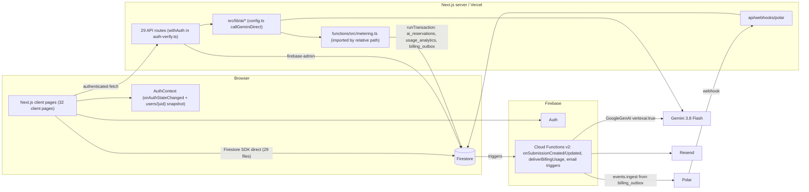

# Workstream B: Architecture and Modularity

Read-only audit, 2026-11-11. Raw evidence: `raw/madge-circular.txt`, `raw/madge-graph.json`, `raw/client-server-trace.txt`, `raw/fallow-*.txt`.

## Task checklist
- [x] **B1** Dependency graph / cycles: `madge --circular` over 289 files found **0 cycles**; fallow-architecture also reports 0 issues. (`--image` SVG not produced: Graphviz not installed; JSON graph saved instead.)
- [x] **B2** Client/server boundary: 153 "use client" files traced transitively against the 8 server modules (firebase-admin, auth-verify, ai/config, rate-limit, usage-limit, polar, class-enrollment, proxy) -> **0 paths**. `server-only` is used in 1 module only (B-006). `NEXT_PUBLIC_*` are all legitimately public (Firebase web config, App Check site key, app URL); the App Check debug token var needs a prod guard (B-011).
- [x] **B3** Page architecture: see table below and B-001, B-007.
- [x] **B4** Data access: 29 client files use the Firestore SDK directly; no repository layer; literals repeated (B-005).
- [x] **B5** Duplication functions/ vs src/: scrubPII copy-pasted, budget policy duplicated, cross-package relative import (B-002, B-003, B-004, B-009).
- [x] **B6** State management: three small contexts, no bloat; auth listener cleanup correct (B-010).
- [x] **B7** Diagram and README drift: below, B-012.

## B3 decomposition proposals
| Page (lines / fn lines / cyclomatic) | Mixed responsibilities | Proposed split |
|---|---|---|
| student/assignment-view/page.tsx (1683 / 1598 / 80) | Firestore fetch (`fetchAssignment` cc 39), countdown/grace timer, answer state, submit, AI helper drawer (mobile + desktop), math input | `useAssignment`, `useSubmissionTimer`, `<QuestionPanel>`, `<AiHelperDrawer>`, `submitAssignment` in data layer |
| student/tutor/page.tsx (1584 / 1387 / 34) | Session list listener, active-session listener, chat streaming, rate-limit UI, sidebar | `useTutorSessions`, `useTutorChat`, `<SessionSidebar>`, `<MessageList>`, `<Composer>` |
| teacher/network/page.tsx (1495 / 1413 / 76) | Org info, members, invites, billing/plan, portfolio, settings | tabs as route segments (`network/members`, `/invites`, `/settings`) with a shared `useNetwork` hook |
| teacher/create/page.tsx (1153 / 1057 / 59) | Form state, AI generation, rubric synthesis, settings, publish | `useAssignmentDraft` reducer, `<QuestionEditor>`, `<AdvancedSettings>`, server action for publish |
| motion/animated-sidebar.tsx (1195; AnimatedSidebarMenuButton cc 37) | Fork of shadcn sidebar with motion, mobile sheet, ref plumbing, 5 compiler violations | Extract motion variants + mobile sheet; fall back to `ui/sidebar.tsx` and delete the fork if unused elsewhere |

## B7 Actual architecture (as implemented)

**Drift vs README:** (1) Polar webhook terminates in the Next route, not Functions; (2) Vertex is the same Gemini call path, not a separate "Enterprise ML" service; (3) metering/outbox pipeline missing from README; (4) Resend is accurate, Brevo (`sib-api-v3-sdk`) is an unused root dependency (0 imports); (5) `functions/src/metering.ts` is imported by the Next app, so the Functions package is not independent.

## Findings
### B-001 - Mega client pages mix data fetching, timers, grading UI and layout in one component
- **Severity:** Medium | **Category:** maintainability | **Effort:** L | **Confidence:** High
- **Location:** `src/app/student/assignment-view/page.tsx:L78-L1675`
- **Evidence:** fallow-health: AssignmentDetailContent 1598 lines (cyclomatic 80); teacher/network/page.tsx:L83 NetworkPage 1413 lines (76); student/tutor/page.tsx:L199 TutorPage 1387; teacher/create/page.tsx:L97 CreateAssignmentForm 1057 (59); student/notebook/page.tsx:L86 NotebookPage 818 (48). All are "use client" pages that call Firestore directly (6/8/10/2/17 direct calls).
- **Impact:** Untestable, slow to review, easy to introduce stale-closure and listener bugs (see H-001/H-002). Compiler bails out on whole-component granularity.
- **Recommendation:** Split each page into a server page.tsx + feature folder: hooks (useAssignment, useSubmissionTimer, useTutorSessions), presentational sections (<QuestionList/>, <AiHelperDrawer/>, <GraceTimer/>), and a data module. Target <300 lines/component.

### B-002 - Next.js app imports Cloud Functions source via relative path ../../../functions/src/metering
- **Severity:** Medium | **Category:** correctness | **Effort:** M | **Confidence:** High
- **Location:** `src/lib/ai/config.ts:L3`
- **Evidence:** src/lib/ai/config.ts:3 `import { reserveBudget, settleBudget, estimateMaximumCost } from '../../../functions/src/metering';` while root tsconfig excludes functions/ and functions/ is a separate package (own node_modules, TS 5.7 vs 5.9, strict flags differ).
- **Impact:** Hidden coupling across two deployables: functions deps/types resolved from the wrong package.json, functions TS settings (noUnusedLocals) are not applied to this code at root, Vercel/standalone builds that omit functions/ would break. Positive: budget logic is single-sourced.
- **Recommendation:** Move metering into a real shared package (e.g. packages/shared or src/shared compiled by both) or publish as workspace package; add path alias and include in both tsconfigs.

### B-003 - Budget policy implemented twice with divergent rules (checkBudget vs reserveBudget)
- **Severity:** Medium | **Category:** correctness | **Effort:** M | **Confidence:** Medium
- **Location:** `src/lib/usage-limit.ts:L7-L83`
- **Evidence:** usage-limit.ts:L35-L47 treats free plan as `!data.planId || planId==='free'` and uses raw aiBudgetLimit; functions/src/metering.ts:L35 caps free plan at Math.min(aiBudgetLimit,50) and only treats planId==='free'. Per-student allowance logic duplicated at usage-limit.ts:L52-L74 and metering.ts:L38-L45. recordUsage (L91-L98) is a no-op stub; checkAndIncrementUsage (L100) is a legacy alias.
- **Impact:** Pre-check can pass while reservation rejects (or vice versa) giving inconsistent errors; a missing planId org gets different caps. Related to the failing security test "concurrent budget reservations" in 00-baseline.
- **Recommendation:** Make reserveBudget the only enforcement point; reduce checkBudget to a thin call to a shared `evaluateBudget(org,user,type)` pure function used by both; delete recordUsage/checkAndIncrementUsage.

### B-004 - PII scrubber copy-pasted between functions and Next app (and grading prompt logic duplicated)
- **Severity:** Medium | **Category:** maintainability | **Effort:** M | **Confidence:** High
- **Location:** `functions/src/grading.ts:L19-L58`
- **Evidence:** fallow-dupes dup:bde308d7: functions/src/grading.ts:19-58 == src/lib/ai/utils.ts:9-67 (scrubPII; comment says 'Ported from src/lib/gemini.ts'). Clone families: functions/src/grading.ts<->src/app/api/grade/route.ts (4 groups, 55 lines), functions/src/grading.ts<->src/lib/ai/grading.ts (2 groups, 50 lines). functions/src/grading.ts:L115 and src/lib/ai/config.ts:L16 both hardcode the model.
- **Impact:** A regex fix to PII scrubbing in one copy silently leaves the other leaking student identifiers to Gemini. Grading rubric/prompt can drift between auto-grade (trigger) and manual-grade (API).
- **Recommendation:** Extract scrubPII + grading prompt builder + score parsing into the shared package from B-002 with unit tests; both callers import it.

### B-005 - No data-access layer: 29 client files call Firestore SDK directly; collection names are string literals everywhere
- **Severity:** Medium | **Category:** maintainability | **Effort:** L | **Confidence:** High
- **Location:** `src/app/student/notebook/page.tsx:L113-L275`
- **Evidence:** rg firebase/firestore in src/app|components|hooks|contexts (excl. api) = 31 files; 29 files call getDocs/onSnapshot/addDoc/setDoc/updateDoc/deleteDoc (notebook 17, tutor 10, network 8, page-client 8, grades 6). src/lib has no repository module; literals repeated: collection(db,"assignments") x14, "courses" x12, "users" x10, "submissions" x10 in client; .collection("users") x49 on server.
- **Impact:** Schema changes require shotgun edits; security-rules-dependent queries (where studentId==) are re-implemented per page; cannot unit-test or cache. Mixes client SDK reads with API-route writes inconsistently.
- **Recommendation:** Add src/lib/data/{collections.ts (typed names + converters), assignments.ts, submissions.ts, notebooks.ts} and hooks (useNotebooks, useTutorSessions). Start with collections.ts constants (S effort).

### B-006 - `server-only` guard used on 1 of 8 server modules
- **Severity:** Low | **Category:** maintainability | **Effort:** S | **Confidence:** High
- **Location:** `src/lib/firebase-admin.ts:L1`
- **Evidence:** rg server-only: only src/lib/ai/config.ts. Server modules without it: firebase-admin.ts, auth-verify.ts, rate-limit.ts, usage-limit.ts, polar.ts, class-enrollment.ts, gemini.ts (proxy.ts is middleware). Positive: import-graph trace (raw/client-server-trace.txt) found 0 paths from the 153 "use client" files to any of these modules.
- **Impact:** Currently safe, but a future client import of auth-verify/firebase-admin would pull firebase-admin into the client bundle and fail only at build/runtime.
- **Recommendation:** Add `import "server-only";` at top of each server-only lib (S).

### B-007 - ~5k lines of marketing "workspace preview" duplicate real app pages
- **Severity:** Medium | **Category:** maintainability | **Effort:** L | **Confidence:** Medium
- **Location:** `src/components/landing/workspace-preview-tabs.tsx:L114-L1525`
- **Evidence:** workspace-preview-pages.tsx 2793 lines, workspace-preview-tabs.tsx 2259 lines (NetworkPage L114, 1411 lines mirrors teacher/network/page.tsx:L83 NetworkPage 1413 lines; CreateAssignmentPage L1550 924 lines mirrors CreateAssignmentForm). Also workspace-preview-data.ts:L675-L707 clones teacher/vault/page.tsx:L62-L94.
- **Impact:** Every product UI change must be mirrored by hand; the copies already contain lint errors (react-hooks/immutability at workspace-preview-pages.tsx:L1642) and ship in the landing bundle.
- **Recommendation:** Replace with screenshots/static video, or render the real presentational components with mock props (after B-001 decomposition); lazy-load via next/dynamic.

### B-008 - Footer / marketing page chrome cloned across 5 pages
- **Severity:** Low | **Category:** maintainability | **Effort:** S | **Confidence:** High
- **Location:** `src/app/features/page.tsx:L616-L679`
- **Evidence:** fallow-dupes: demos/page.tsx:196-255, features/page.tsx:616-679, pricing/page.tsx:373-435, sustainability/page.tsx:23-108 and landing/LandingFooter.tsx:13-75 are clone families (up to 5 instances, 64 lines). login/page.tsx<->signup/page.tsx 66 lines; teacher grades/students pages 38 lines.
- **Impact:** Footer edits (e.g. © year, links) must be made in 5 places.
- **Recommendation:** Use components/landing/LandingFooter.tsx everywhere; extract <AuthShell/> for login/signup.

### B-009 - Model name and vendor hardcoded in three places
- **Severity:** Low | **Category:** maintainability | **Effort:** S | **Confidence:** High
- **Location:** `functions/src/billing.ts:L14`
- **Evidence:** 'gemini-3.8-flash' at functions/src/billing.ts:14 (Polar event metadata), functions/src/grading.ts:115, src/lib/ai/config.ts:16; token rates in metering.ts:L5-L10 assume that same model.
- **Impact:** Changing model without updating billing metadata/rates mis-bills the customer.
- **Recommendation:** Single exported MODEL_ID + RATES table in the shared package; billing metadata reads it.

### B-010 - State management is small and sound; minor unmemoized context values
- **Severity:** Info | **Category:** maintainability | **Effort:** S | **Confidence:** Medium
- **Location:** `src/contexts/appearance-context.tsx:L94`
- **Evidence:** contexts total 274 lines (auth 94, appearance 106, space-effects 74). Provider values at appearance-context.tsx:94 and space-effects-context.tsx:55 are inline object literals; auth-context.tsx:91 passes state directly. auth-context.tsx:L20-L70 correctly unsubscribes both auth and profile listeners and guards with `disposed`. No prop-drilling hotspots found.
- **Impact:** With reactCompiler enabled the literals are auto-memoized, so impact is negligible; auth context re-renders all consumers on every profile snapshot (expected).
- **Recommendation:** Optional: split AuthContext into state/actions or use selectors if profile snapshots become chatty.

### B-011 - No circular dependencies; clean client→server boundary
- **Severity:** Info | **Category:** maintainability | **Effort:** S | **Confidence:** Medium
- **Location:** `src`
- **Evidence:** madge --circular on 289 files: "No circular dependency found" (raw/madge-circular.txt). fallow-architecture: 0 issues across 134 entry points. Trace of 153 client files → 8 server modules: 0 hits (raw/client-server-trace.txt). NEXT_PUBLIC_* vars are only Firebase web config, App Check site key/provider, APP_URL, and NEXT_PUBLIC_FIREBASE_APPCHECK_DEBUG_TOKEN.
- **Impact:** Positive. One note: NEXT_PUBLIC_FIREBASE_APPCHECK_DEBUG_TOKEN must never be set in production (it bypasses App Check).
- **Recommendation:** Document in .env.example that the debug token is dev-only; assert unset in prod build.

### B-012 - README architecture diagram drifts from implementation
- **Severity:** Low | **Category:** maintainability | **Effort:** S | **Confidence:** High
- **Location:** `README.md:L58-L113`
- **Evidence:** README:L82 Functions-->Resend is correct (functions/src/lib/email.ts uses Resend) but README:L113-L114 diagram shows "Polar -- Webhook --> Functions" whereas the webhook is a Next route (src/app/api/webhooks/polar/route.ts); Vertex is shown as separate "Enterprise ML" but all text generation uses the same Gemini model via GoogleGenAI(vertexai:true) in functions/src/grading.ts:L11-L15; billing_outbox → Polar events.ingest delivery (functions/src/billing.ts) and ai_reservations metering are not shown. sib-api-v3-sdk (Brevo) is a root dependency (package.json:L84) with 0 imports in src/ or functions/.
- **Impact:** New contributors get a wrong mental model of where billing events are processed.
- **Recommendation:** Replace with the diagram in B-architecture.md §B7; remove sib-api-v3-sdk (see J workstream).

## Score: **3 / 5**
No cycles and a clean client/server boundary are real strengths, and the auth context is well written. Held back by 1.1-1.6k-line client pages doing their own Firestore I/O, no data-access layer, security- and billing-relevant logic duplicated across the Next/Functions boundary (PII scrubber, budget policy) and a cross-package relative import. Counts: 0 Critical, 0 High, 6 Medium, 4 Low, 2 Info.
