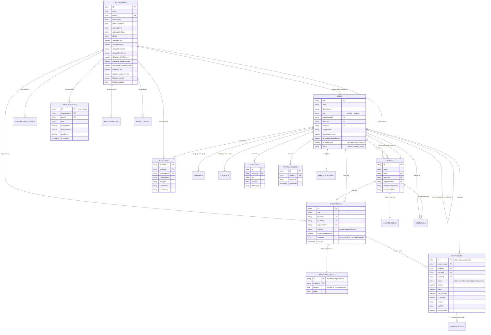

# Workstream D: Firebase Rules and Data Model (`D-firebase-rules.md`)

**Date:** 2026-11-11  
**Auditor:** Agent (Workstream D)  
**Scope:** `firestore.rules`, `storage.rules`, `firestore.indexes.json`, `tests/security/*.test.*`, `tools/migrate-school-security.cjs`, `src/lib/types.ts`, and all Firestore/Storage queries & writes across `src/` and `functions/src/`.

---

## Task Checklist

- [x] **D1** Review `firestore.rules` line by line: default deny, no `allow read, write: if true`, role derivation (claims vs. `get()` doc reads), cross-tenant isolation, student `grade`/`score` write protection, field-level validation on `create`/`update`, and client-vs-rules compatibility.
- [x] **D2** Review `storage.rules`: path ownership, size limits, content-type restrictions, and alignment with client upload code.
- [x] **D3** Cross-check `firestore.indexes.json` against every `where(` / `orderBy(` query in `src/` and `functions/src/`; list missing and unused indexes.
- [x] **D4** Assess existing rules/security tests in `tests/security/*.test.*`, diagnose the failing test in `raw/test-security.txt`, and build a collection × operation × role coverage matrix.
- [x] **D5** Review `tools/migrate-school-security.cjs` for dry-run safety, idempotency, and transactional integrity.
- [x] **D6** Document the complete Firestore data model as a Mermaid `erDiagram` and flag denormalization inconsistencies.

---

## D1. Line-by-Line Review of `firestore.rules`

### 1.1 Rule-by-Rule Audit Table (`firestore.rules:L1-L100`)

| Lines | Block / Match | Summary of Logic | Security & Correctness Assessment |
|---|---|---|---|
| `L1-L21` | Helper Functions (`signedIn`, `user`, `me`, `teacher`, `member`, `teaches`, `ownsCourse`, `assignment`, `ownsAssignment`, `enrolled`) | Uses `get(/databases/$(database)/documents/users/$(request.auth.uid)).data` to resolve caller role, `organizationId`, `courseId`, and `teacherId`. | **Performance / Cost Debt (`D-007`):** Role and tenant derivation rely entirely on Firestore `get()` calls rather than Firebase Auth custom claims (`request.auth.token.role`, `request.auth.token.organizationId`). Evaluating `teaches(user(resource.data.studentId).get('teacherId', null))` on `/practice_history` or `/portfolios` performs **3 chained `get()` reads** (`me()`, `user(studentId)`, `user(teacherId)`). |
| `L22-L36` | `match /users/{id}` | **Read (`L23-L25`):** Own doc, teacher in same org / teaching student / owning course, or student reading own teacher (`me().get('teacherId', null) == id`).<br>**Create (`L28-L30`):** Only teachers creating `status == 'pending_invite'` student roster placeholders.<br>**Update (`L31-L35`):** Self-update restricted to `['displayName','email','lastLoginAt','preferences','appearance','photoURL','theme']`; teacher can unlink student (`teacherId/courseId/organizationId == null`). | **3 Issues Found:**<br>1. **`D-001` (High):** `src/app/student/notebook/page.tsx:L424` calls `updateDoc(doc(db, "users", user.uid), { aiUsageCount: increment(1) })`, which is blocked by `hasOnly(...)` on `L32`, causing every Notebook Copilot message to fail with `PERMISSION_DENIED`!<br>2. **`D-005` (Medium):** Self-update allows changing `email` in Firestore to any arbitrary string without matching `request.auth.token.email`; `onAssignmentCreated` (`functions/src/index.ts:L99`) then sends Resend emails to `student.email`.<br>3. Student read (`me().get('teacherId', null) == id`) exposes the teacher's full `users/{teacherId}` document (including `preferences`, `lastLoginAt`, etc.) to enrolled students. |
| `L37-L42` | `match /students/{id}` & `match /teachers/{id}` | Read-only from client (`allow read`); all writes performed server-side via Admin SDK (`/api/auth/register`, `/api/student/enrollment`, `/api/teacher/students/cleanup`). | ✅ Safe read isolation; however, these legacy mirror collections drift from `users/{id}` on profile updates and network membership changes (see `D-007`). |
| `L43-L48` | `match /assignments/{id}` | **Read (`L45-L46`):** Teacher (own, `global`, or same `organizationId`) or enrolled student **only if** `answerKeySeparated == true`.<br>**Delete (`L47`):** Owning teacher (`resource.data.teacherId == request.auth.uid`).<br>**Create / Update:** Denied to client. | **`D-002` (High):** Missing `allow update` rule! `src/app/teacher/assignments/page.tsx:L130` calls `updateDoc(doc(db, "assignments", id), { visibility })` from the client SDK to share/unshare assignments to Waypoints (`private` / `network` / `global`), which **always fails with `PERMISSION_DENIED`**. |
| `L49-L51` | `match /assignment_keys/{id}` | **Read (`L50`):** `ownsAssignment(id)` (`assignment(id).teacherId == request.auth.uid`).<br>**Write:** Server-only. | ⚠️ **Subtle Bug in Colleague Forking vs Direct Read:** `GET /api/assignments` (`src/app/api/assignments/route.ts:L33-L35`) allows network colleagues and global teachers to read `assignment_keys` via Admin SDK, which works, while direct client reads are locked to `ownsAssignment(id)`. Students are completely blocked from reading answer keys. |
| `L52-L58` | `match /submissions/{id}` | **Read (`L53`):** Submitting student (`studentId == request.auth.uid`) or owning teacher (`ownsAssignment(assignmentId)`).<br>**Create:** Denied to client (handled via `POST /api/submissions`).<br>**Update (`L55-L56`):** Only `ownsAssignment(resource.data.assignmentId)` with immutable `assignmentId` and `studentId`.<br>**Delete (`L57`):** `ownsAssignment(resource.data.assignmentId)`. | ✅ **Strong Security:** Students **cannot** create submissions directly or modify `score`, `graded`, `earnedPoints`, or `answers` after creation; all student draft/final saves go through `/api/submissions`. Note: Colleague teachers in the same network cannot read or grade another teacher's class submissions unless they own the assignment. |
| `L59-L64` | `match /courses/{id}` | **Read (`L60`):** Course teacher, enrolled student (`me().courseId == id`), or network colleague (`teaches(resource.data.teacherId)`).<br>**Update (`L62`):** `ownsCourse(id)` with immutable `teacherId` and `organizationId`.<br>**Delete (`L63`):** `ownsCourse(id)`. | ⚠️ `allow update` (`L62`) does not restrict other fields (`code`, `name`, `customFormulas`, `restrictedFormulaIds`). If a teacher changes `code` directly via client SDK, `course_codes/{code}` would become desynchronized. |
| `L65-L69` | `match /resources/{id}` | **Read (`L66`):** `teaches(resource.data.teacherId)` or student of that teacher.<br>**Create/Update/Delete (`L67-L68`):** `teacher() && teacherId == request.auth.uid`. | ⚠️ `allow update` (`L68`) checks `resource.data.teacherId == request.auth.uid` but does **not** check `request.resource.data.teacherId == resource.data.teacherId`, allowing a teacher to reassign `teacherId` on a resource doc to another teacher. Also lacks field/size validation. |
| `L70-L85` | `match /practice_history/{id}`, `match /notebooks/{id}`, `match /tutor_sessions/{id}` | Any signed-in user can `create` if `request.resource.data.studentId == request.auth.uid`, and `update`/`delete` if `resource.data.studentId == request.auth.uid`. For `notebooks` and `tutor_sessions`, `read` and `delete` also allow `id == request.auth.uid`. | **`D-003` (High):**<br>1. `notebookLimitPerStudent` is enforced only in client JS (`src/app/student/notebook/page.tsx:L300`), not in `firestore.rules` or an API route.<br>2. Because `allow create` only checks `request.resource.data.studentId == request.auth.uid` and `allow read, delete` allows `id == request.auth.uid`, User A can create `/notebooks/<uidB>` with `{ studentId: uidA, content: "<payload>" }`. When User B first visits NotebookPage (`src/app/student/notebook/page.tsx:L182-L198`), User B's client reads `/notebooks/<uidB>` and migrates User A's content into User B's notebook!<br>3. Zero field allowlisting or payload size bounds on `create`/`update`. |
| `L86-L91` | `match /organizations/{id}` | **Read (`L87`):** `member(id)`.<br>**Update (`L88-L90`):** Owner (`ownerId == request.auth.uid`) can update limit/name fields (cannot raise `aiBudgetLimit` on `free` plan) or transfer `ownerId` to a teacher in the same org. | ✅ Well-designed protection against self-upgrading `planId`, forging `subscriptionStatus`, or resetting `aiUsageCurrent`. |
| `L92-L97` | `match /portfolios/{id}` & `match /usage_analytics/{id}` | Read-only (`portfolios`: student or teacher in network; `usage_analytics`: teacher in org). All writes are server-only. | ✅ Safe. |
| `L98-L100` | Server-only collections (implicit default deny) | `teacherInviteCodes`, `accessRequests`, `course_codes`, `billing_events`, `billing_outbox`, `ai_reservations`, `rate_limits`, `grading_locks`, `support_tickets`, `landing_visitors` have no match block and default to `allow read, write: if false`. | ✅ Default-deny posture is properly maintained for all internal/billing/security collections. |

---

## D2. Review of `storage.rules`

```
rules_version = '2';
service firebase.storage {
  match /b/{bucket}/o {
    function ownStudent(id) {
      let caller = firestore.get(/databases/(default)/documents/users/$(request.auth.uid)).data;
      let student = firestore.get(/databases/(default)/documents/users/$(id)).data;
      return caller.role == 'teacher' && student.teacherId == request.auth.uid;
    }
    match /submissions/{userId}/{allPaths=**} {
      allow read, delete: if request.auth != null && (request.auth.uid == userId || ownStudent(userId));
      allow create, update: if request.auth != null && request.auth.uid == userId &&
        request.resource.size < 25 * 1024 * 1024 &&
        (request.resource.contentType.matches('image/.*') || request.resource.contentType == 'application/pdf' || request.resource.contentType.matches('text/.*'));
    }
  }
}
```

### Assessment & Findings (`D-006`):
1. **Path Ownership & Student Submissions:**
   - Students can only upload/modify files under `/submissions/{request.auth.uid}/**`.
   - Maximum size is bounded at **25 MiB** (`25 * 1024 * 1024`).
   - Content types are restricted to `image/.*`, `application/pdf`, and `text/.*` (note: `text/html` matches `text/.*`, which could be a stored XSS risk if served directly without `Content-Disposition: attachment`, though Firebase Storage download URLs set `Content-Disposition: inline` — restricting `text/.*` to `text/plain` and `text/csv` is safer).
2. **Broken Teacher Resource Uploads (`D-006` — Medium):**
   - In `src/app/teacher/uploads/page.tsx:L95-L103`, teachers upload course resources (including videos: `if (file.type.startsWith("video/")) finalType = "video";`) by calling `uploadFilesToStorage([file], user.uid, ...)`.
   - `uploadFilesToStorage` (`src/lib/firebase.ts:L210`) writes to `submissions/${userId}/${fileName}`.
   - Because `storage.rules:L13` only permits `image/.*`, `application/pdf`, and `text/.*`, **all teacher video uploads fail with `storage/unauthorized`**!
   - Furthermore, storing teacher course resources inside `submissions/{teacherUid}/` means Storage read rules (`request.auth.uid == userId || ownStudent(userId)`) do **not** allow students to read `/submissions/{teacherUid}/...` via the Storage SDK (they rely solely on the unauthenticated capability token embedded in `getDownloadURL()`).
3. **Submission Immutability After Grading:**
   - Because `allow update, delete` on `/submissions/{userId}/{allPaths=**}` is always true for `request.auth.uid == userId`, a student can overwrite or delete their uploaded work file in Firebase Storage **after** a submission has been finalized or graded, altering the evidence attached to their graded submission.

---

## D3. Firestore Indexes Audit (`firestore.indexes.json` vs. Codebase Queries)

### 3.1 Existing Indexes in `firestore.indexes.json` (8 Total)

| # | Collection | Indexed Fields | Used in Codebase? | Query Location(s) |
|---:|---|---|---|---|
| 1 | `resources` | `teacherId ASC`, `createdAt DESC` | ✅ Yes | `src/app/student/resources/page.tsx:L68-L72`, `src/app/teacher/uploads/page.tsx:L66-L70` |
| 2 | `assignments` | `teacherId ASC`, `createdAt DESC` | ✅ Yes | `src/app/teacher/page-client.tsx:L166-L171` |
| 3 | `courses` | `teacherId ASC`, `createdAt DESC` | ❌ **Unused** | All `courses` queries filter only by `where("teacherId", "==", uid)` without `orderBy("createdAt", "desc")`. |
| 4 | `tutor_sessions` | `studentId ASC`, `updatedAt DESC` | ✅ Yes | `src/app/api/teacher/network/portfolio/route.ts:L48-L52` |
| 5 | `assignments` | `visibility ASC`, `organizationId ASC` | ✅ Yes | `src/app/teacher/waypoints/page.tsx:L101-L105`, `tests/security/full-student-teacher-workflow.test.ts:L751-L754` |
| 6 | `assignments` | `visibility ASC`, `topic ASC` | ✅ Yes | `src/app/teacher/waypoints/page.tsx:L77-L81` |
| 7 | `assignments` | `visibility ASC`, `organizationId ASC`, `topic ASC` | ✅ Yes | `src/app/teacher/waypoints/page.tsx:L94-L99` |
| 8 | `usage_analytics` | `organizationId ASC`, `timestamp DESC` | ✅ Yes | `src/components/admin/usage-analytics.tsx:L86-L91` |

### 3.2 Missing Composite Indexes (`D-007`)
In Cloud Firestore, single-field equality queries use automatic single-field indexes, and multiple equality (`==`) filters *can* sometimes be satisfied by zigzag merge joins, **but** any query combining `in` + `==`, or multiple `==` filters with high fan-out / security-rule limits, requires or strongly benefits from a composite index in `firestore.indexes.json`:

| # | Collection | Query Filter Fields | Required / Recommended By | Codebase Location(s) |
|---:|---|---|---|---|
| 1 | `users` | `courseId` (`in`), `role` (`==`) | **Required** (`in` + `==` composite) | `src/app/teacher/page-client.tsx:L119`, `src/app/teacher/students/page.tsx:L85` |
| 2 | `users` | `teacherId` (`in`), `role` (`==`) | **Required** (`in` + `==` composite) | `src/components/teacher/network-students.tsx:L35-L36`, `src/app/teacher/network/page.tsx:L397-L398`, `src/app/api/chat/limits/route.ts:L55-L56` |
| 3 | `submissions` | `studentId` (`==`), `assignmentId` (`in`) | **Required** (`==` + `in` composite) | `src/app/teacher/grades/student/page.tsx:L72` |
| 4 | `users` | `organizationId` (`==`), `role` (`==`) | Recommended composite | `src/app/teacher/network/page.tsx:L387-L388`, `src/app/teacher/students/page.tsx:L56-L57`, `src/app/api/auth/register/route.ts:L32`, `src/app/api/teacher/network/membership/route.ts:L27`, `src/app/api/chat/limits/route.ts:L49-L50` |
| 5 | `users` | `teacherId` (`==`), `role` (`==`) | Recommended composite | `functions/src/grading.ts:L202-L203`, `functions/src/index.ts:L81-L82`, `src/app/api/grade/route.ts:L65-L66`, `src/app/api/student/tutor/route.ts:L49-L50`, `src/app/teacher/page-client.tsx:L117`, `src/app/teacher/students/page.tsx:L83` |
| 6 | `users` | `courseId` (`==`), `role` (`==`) | Recommended composite | `src/app/teacher/grades/page.tsx:L138`, `tests/security/full-student-teacher-workflow.test.ts:L333-L334` |
| 7 | `assignments` | `answerKeySeparated` (`==`), `courseId` (`==`) | Recommended composite | `src/app/student/assignments/page.tsx:L57`, `src/app/student/page-client.tsx:L128` |
| 8 | `assignments` | `answerKeySeparated` (`==`), `teacherId` (`==`), `courseId` (`==`) | Recommended composite (3-field) | `src/app/student/assignments/page.tsx:L67`, `src/app/student/page-client.tsx:L139` |
| 9 | `submissions` | `assignmentId` (`==`), `studentId` (`==`) | Recommended composite | `src/app/student/assignment-view/page.tsx:L270-L271` |
| 10 | `courses` | `teacherId` (`==`), `code` (`==`) | Recommended composite | `src/app/teacher/students/page.tsx:L68` |
| 11 | `accessRequests` | `email` (`==`), `status` (`==`) | Recommended composite | `src/app/api/auth/request-access/route.ts:L125-L126` |

---

## D4. Security & Emulator Rules Test Assessment (`tests/security/`)

### 4.1 Execution Results (`raw/test-security.txt`)
Running `npm run test:security` launched the Firestore (`127.0.0.1:8188`) and Storage (`127.0.0.1:9298`) emulators and ran 4 test suites (34 tests total):
- ✅ `tests/security/rules.test.cjs` — **PASS** (12 tests)
- ✅ `tests/security/full-student-teacher-workflow.test.ts` — **PASS** (11 comprehensive E2E tests)
- ✅ `tests/security/webhooks.test.ts` — **PASS** (2 tests)
- ❌ `tests/security/workflows.test.ts` — **FAIL** (8 passed, **1 failed**):
  - **Failing Test (`D-004`):** `concurrent budget reservations cannot exceed the cap; settlement is idempotent` (`tests/security/workflows.test.ts:L54-L61`):
    ```ts
    await settleBudget(adminDb,id,1000,1000);await settleBudget(adminDb,id,1000,1000);
    const org=(await adminDb.collection('organizations').doc('budget').get()).data()!;
    expect(org.aiUsageReserved).toBe(0);
    expect(org.aiUsageCurrent).toBeCloseTo(0.28); // <-- Received: 0.45
    ```
  - **Root Cause:** `functions/src/metering.ts:L7-L12` updated `TOKEN_RATES` to Gemini 3.8 Flash introductory pricing (`input: 0.000075` cents/token, `output: 0.000375` cents/token), so `1000 * 0.000075 + 1000 * 0.000375 = 0.45` cents, whereas the test still asserts the legacy rate (`0.28` cents).

### 4.2 Rules Coverage Matrix (Collection × Operation × Role)
Legend: ✅ Tested (positive & negative cases) | 🟡 Partial (only positive or only negative tested) | ❌ Untested in `tests/security/` | 🔒 Server-Only (no client rule)

| Collection | Unauth Read/Write | Student Read | Student Create | Student Update | Student Delete | Teacher Read (Own/Org) | Teacher Read (Cross-Org) | Teacher Create | Teacher Update | Teacher Delete |
|---|---|---|---|---|---|---|---|---|---|---|
| `users` | ✅ (`rules.test.cjs:L27`) | ✅ (`full:L300`) | ✅ (`rules.test.cjs:L28`) | ✅ (`rules.test.cjs:L29-L31`) | ❌ Untested | ✅ (`rules.test.cjs:L33-L34`) | ✅ (`rules.test.cjs:L38`) | ✅ (`full:L276` placeholder) | ✅ (`full:L810` unlink) | ❌ Untested |
| `students` | ❌ Untested | ❌ Untested | 🔒 Denied | 🔒 Denied | 🔒 Denied | ❌ Untested | ❌ Untested | 🔒 Denied | 🔒 Denied | 🔒 Denied |
| `teachers` | ❌ Untested | ❌ Untested | 🔒 Denied | 🔒 Denied | 🔒 Denied | ❌ Untested | ❌ Untested | 🔒 Denied | 🔒 Denied | 🔒 Denied |
| `assignments` | ❌ Untested | ✅ (`rules.test.cjs:L41-L45`) | 🔒 Denied | ❌ Untested | ❌ Untested | ✅ (`full:L748`) | ❌ Untested | 🔒 Denied (via API) | ❌ **Untested (`D-002` bug!)** | 🟡 (`full` via trigger) |
| `assignment_keys` | ❌ Untested | ✅ (`rules.test.cjs:L43`) | 🔒 Denied | 🔒 Denied | 🔒 Denied | ❌ Direct read untested | ✅ (`rules.test.cjs:L38`) | 🔒 Denied | 🔒 Denied | 🔒 Denied |
| `submissions` | ❌ Untested | ✅ (`full:L668,L696`) | ✅ (`rules.test.cjs:L48`) | ✅ (`rules.test.cjs:L47`) | ❌ Untested | ✅ (`rules.test.cjs:L35`) | ✅ (`rules.test.cjs:L38`) | 🔒 Denied | ✅ (`full:L653`) | ❌ Untested |
| `courses` | ❌ Untested | ✅ (`full:L343`) | 🔒 Denied | ❌ Untested | ❌ Untested | ✅ (`full:L246`) | ✅ (`rules.test.cjs:L38-L39`) | 🔒 Denied (via API) | ✅ (`full:L246`) | ❌ Untested |
| `resources` | ❌ Untested | ✅ (`full:L350`) | ❌ Untested | ❌ Untested | ❌ Untested | ❌ Untested | ❌ Untested | ✅ (`full:L264`) | ❌ Untested | ❌ Untested |
| `practice_history` | ❌ Untested | ❌ Untested | ❌ Untested | ❌ Untested | ❌ Untested | ❌ Untested | ❌ Untested | ❌ Untested | ❌ Untested | ❌ Untested |
| `notebooks` | ❌ Untested | 🟡 (`full:L480`) | ✅ (`rules.test.cjs:L51`) | ❌ Untested | ❌ Untested | ❌ Untested | ❌ Untested | ❌ Untested | ❌ Untested | ❌ Untested |
| `tutor_sessions` | ❌ Untested | 🟡 (`full:L469`) | ✅ (`rules.test.cjs:L52`) | ❌ Untested | ❌ Untested | ❌ Untested | ❌ Untested | ❌ Untested | ❌ Untested | ❌ Untested |
| `organizations` | ❌ Untested | ❌ Untested | 🔒 Denied | ❌ Untested | 🔒 Denied | ✅ (`full:L208`) | ❌ Untested | 🔒 Denied | ✅ (`rules.test.cjs:L54-L57`) | 🔒 Denied |
| `portfolios` | ❌ Untested | ✅ (`full:L784`) | 🔒 Denied | 🔒 Denied | 🔒 Denied | ✅ (`rules.test.cjs:L63`, `full:L782-L783`) | ✅ (`rules.test.cjs:L38,L64`) | 🔒 Denied | 🔒 Denied | 🔒 Denied |
| `usage_analytics` | ❌ Untested | ❌ Untested | 🔒 Denied | 🔒 Denied | 🔒 Denied | ❌ Untested | ❌ Untested | 🔒 Denied | 🔒 Denied | 🔒 Denied |
| `storage (/submissions)` | ❌ Untested | ✅ (`rules.test.cjs:L68`) | ✅ (`rules.test.cjs:L68,L71`) | ❌ Untested | ❌ Untested | ✅ (`rules.test.cjs:L69`) | ✅ (`rules.test.cjs:L70`) | ❌ **Untested (`D-006` bug!)** | ❌ Untested | ❌ Untested |

---

## D5. Review of `tools/migrate-school-security.cjs`

**File:** `tools/migrate-school-security.cjs:L1-L32`
- **Project Safety (`L3-L5`):** Explicitly requires `process.env.FIREBASE_PROJECT_ID` (`if (!projectId) throw new Error('Set FIREBASE_PROJECT_ID explicitly; do not infer the production project');`) and uses `admin.credential.applicationDefault()`.
- **Dry-Run Default (`L1, L7, L18, L30`):** Defaults to read-only dry-run mode unless `--apply` is passed on the CLI (`const apply = process.argv.includes('--apply');`).
- **Pagination (`L9-L29`):** Paginates through `assignments` ordered by `FieldPath.documentId()` in batches of 100 using `startAfter(cursor)`.
- **Idempotency & Transactional Integrity (`L15, L18-L26`):**
  - Skips documents where `data.answerKeySeparated` is already truthy (`L15`).
  - When `--apply` is active, wraps each document migration in `db.runTransaction`, re-reads the live `assignments/{id}` document (`L19-L20`), extracts `correctAnswer` into `assignment_keys/{id}` (`L23-L24`), and sets `rubric: null, answerKeySeparated: true` on `assignments/{id}` (`L25`).
- **Minor Edge Case:** If a legacy assignment has a question without `q.id` (`undefined`), `keys[q.id]` sets `keys["undefined"] = ...`. Calling `splitAssignmentQuestions()` from `src/lib/assignment-security.ts` (or validating `q.id` before migrating) would catch malformed legacy question IDs.

---

## D6. Firestore Data Model & Denormalization Analysis

### 6.1 Complete Entity-Relationship Diagram (All 21 Collections)



*(Additional server-only operational collections not connected by foreign keys: `accessRequests`, `billing_events`, `rate_limits`, `support_tickets`, `landing_visitors`.)*

### 6.2 Denormalization & Consistency Risks (`D-001`, `D-007`)
1. **Triple-Collection User Storage (`users/{uid}` vs. `students/{uid}` vs. `teachers/{uid}`):**
   - `/api/auth/register` (`L43-L44`) writes to both `users/{uid}` and `teachers/{uid}` or `students/{uid}`.
   - `/api/student/enrollment` (`L28-L29`) updates both `users/{uid}` and `students/{uid}`.
   - **However**, `/api/teacher/network/membership` (`L18, L28, L44`) updates `organizationId` **only** on `users/{uid}` and never updates `teachers/{uid}`! Similarly, `updateUserProfile` (`src/lib/firebase.ts:L356-L360`) updates only `users/{uid}`.
2. **Stale `organizationId` on Students When Teacher Changes Network:**
   - When a student enrolls in a course, `organizationId` is copied from `course.organizationId` onto `users/{studentUid}` (`src/app/api/student/enrollment/route.ts:L26`).
   - If a teacher later leaves or switches networks (`/api/teacher/network/membership`) or creates a course before joining a network, `courses/{courseId}.organizationId` and `users/{studentUid}.organizationId` are not updated. Several API routes (`/api/chat`, `/api/grade`, `/api/notebook/chat`, `/api/student/tutor`) contain fallback code to look up `users/{studentData.teacherId}.organizationId` only when `studentData.organizationId` is falsy — if `studentData.organizationId` is non-null but stale, it points to the old organization!
3. **Conflicting Notebook AI Usage Counters (`aiUsageCount` vs. `aiNotebookUsageCurrent` vs. `notebookUsageCurrent`):**
   - `functions/src/metering.ts:L32` and `src/lib/usage-limit.ts:L69` track per-student monthly notebook AI usage in `users/{uid}.aiNotebookUsageCurrent` (reset monthly via `usageMonth`).
   - `src/app/api/notebook/chat/route.ts:L51,L75` ALSO increments `organizations/{orgId}.notebookUsageCurrent` (which is only reset on Polar subscription renewal, not monthly for free plans).
   - Meanwhile, `src/app/student/notebook/page.tsx:L115,L425` reads and tries to client-increment `users/{uid}.aiUsageCount` (which is blocked by `firestore.rules:L32`, see `D-001`)!
4. **Denormalized `studentName` / `studentEmail` in `submissions/{id}`:**
   - `POST /api/submissions` (`L45`) copies `studentName: profile.displayName` and `studentEmail: caller.email` into each submission document; if a student updates their `displayName` in Settings, existing submissions retain the old name.

---

## Detailed Findings (Workstream D)

### `D-001` — Student Notebook Copilot Triggers `PERMISSION_DENIED` on Every Message Due to Client `users/{uid}.aiUsageCount` Write Blocked by `firestore.rules`
| Field | Value |
|---|---|
| **ID** | `D-001` |
| **Severity** | **High** |
| **Category** | `correctness` |
| **Location** | `src/app/student/notebook/page.tsx:L115,L422-L427` |
| **Effort** | `S` (<1h) |
| **Confidence** | `High` |

**Evidence:**
```tsx
// src/app/student/notebook/page.tsx:L113-L116
const unsubscribe = onSnapshot(doc(db, "users", user.uid), (doc) => {
  if (doc.exists()) {
    setStudentUsage(doc.data().aiUsageCount || 0);
  }
});
// src/app/student/notebook/page.tsx:L422-L427
if (user) {
  const userRef = doc(db, "users", user.uid);
  await updateDoc(userRef, {
    aiUsageCount: increment(1)
  });
}
```
While `firestore.rules:L31-L32` strictly limits self-updates on `/users/{id}`:
```
allow update: if signedIn() && (
  (id == request.auth.uid && request.resource.data.diff(resource.data).affectedKeys().hasOnly(['displayName','email','lastLoginAt','preferences','appearance','photoURL','theme'])) || ...
```
And `functions/src/metering.ts:L32` already increments `aiNotebookUsageCurrent` server-side inside `reserveBudget()`.
**Impact:**
1. Every time a student sends a message to Raise Copilot in the Notebook, `await updateDoc(userRef, { aiUsageCount: increment(1) })` throws `FirebaseError: Missing or insufficient permissions` (`PERMISSION_DENIED`), which jumps into `catch (error) { toast.error("Copilot connection severed."); }` (`L428-L429`) even though the AI response succeeded!
2. Because `NotebookPage` reads `doc.data().aiUsageCount || 0` (`L115`) instead of `aiNotebookUsageCurrent`, the student usage progress bar in the Notebook header permanently shows `0 / <limit>`.
**Recommendation:**
1. Delete the client-side `await updateDoc(userRef, { aiUsageCount: increment(1) })` block at `src/app/student/notebook/page.tsx:L422-L427` (usage is already incremented transactionally by `reserveBudget` in `functions/src/metering.ts:L38`).
2. Update `src/app/student/notebook/page.tsx:L115` to read `doc.data().usageMonth === new Date().toISOString().slice(0, 7) ? (doc.data().aiNotebookUsageCurrent || 0) : 0`.

---

### `D-002` — Missing `allow update` Rule on `/assignments/{id}` Breaks Teacher Assignment Visibility Updates (Waypoints Sharing)
| Field | Value |
|---|---|
| **ID** | `D-002` |
| **Severity** | **High** |
| **Category** | `correctness` |
| **Location** | `firestore.rules:L43-L48` |
| **Effort** | `S` (<1h) |
| **Confidence** | `High` |

**Evidence:**
```tsx
// src/app/teacher/assignments/page.tsx:L128-L135
async function updateVisibility(id: string, visibility: "private" | "network" | "global") {
  try {
    await updateDoc(doc(db, "assignments", id), { visibility });
    setAssignments(assignments.map(a => a.id === id ? { ...a, visibility } : a));
  } catch (error) {
    console.error("Error updating visibility:", error);
  }
}
```
And in `firestore.rules:L43-L48`:
```
match /assignments/{id} {
  allow read: if signedIn() && ((teacher() && (resource.data.teacherId == request.auth.uid || resource.data.visibility == 'global' || member(resource.data.get('organizationId', null)))) ||
    (resource.data.get('answerKeySeparated', false) == true && enrolled(resource.data)));
  allow delete: if teacher() && resource.data.teacherId == request.auth.uid;
}
```
**Impact:**
Because `/assignments/{id}` has no `allow update` rule in `firestore.rules`, any teacher attempting to change an assignment's visibility (`private` / `network` / `global`) in `/teacher/assignments` receives `PERMISSION_DENIED`, and the error is silently swallowed by `console.error("Error updating visibility:", error)` without even showing a toast.
**Recommendation:**
Add a restricted `allow update` rule on `/assignments/{id}` in `firestore.rules`:
```
allow update: if teacher() && resource.data.teacherId == request.auth.uid &&
  request.resource.data.diff(resource.data).affectedKeys().hasOnly(['visibility']) &&
  request.resource.data.visibility in ['private', 'network', 'global'];
```
(Or route visibility updates through `PATCH /api/assignments` and show `toast.error` on failure.)

---

### `D-003` — Unbounded Client Writes & Document-ID Squatting on `notebooks` and `tutor_sessions` Bypass Quota Limits and Enable Cross-Student Content Injection
| Field | Value |
|---|---|
| **ID** | `D-003` |
| **Severity** | **High** |
| **Category** | `security` |
| **Location** | `firestore.rules:L76-L85` |
| **Effort** | `M` (<1 day) |
| **Confidence** | `High` |

**Evidence:**
```
// firestore.rules:L76-L85
match /notebooks/{id} {
  allow read, delete: if signedIn() && (resource.data.studentId == request.auth.uid || id == request.auth.uid);
  allow create: if signedIn() && request.resource.data.studentId == request.auth.uid;
  allow update: if signedIn() && resource.data.studentId == request.auth.uid && request.resource.data.studentId == resource.data.studentId;
}
```
And in `src/app/student/notebook/page.tsx:L182-L198`:
```tsx
const oldRef = doc(db, "notebooks", user.uid);
const oldSnap = await getDoc(oldRef);
if (oldSnap.exists()) {
  const oldData = oldSnap.data();
  if (!oldData.studentId) { ... }
}
```
**Impact:**
1. **Cross-Student Squatting / Interference:** `allow create` on `/notebooks/{id}` and `/tutor_sessions/{id}` only verifies `request.resource.data.studentId == request.auth.uid` and does not prevent setting `id` to another user's UID (`uidB`). If Student A creates `/notebooks/uidB` with `{ studentId: uidA }`, Student B (`id == request.auth.uid`) can read and delete Student A's document (`L77`), or Student A can squat on `/notebooks/uidB` so Student B's legacy lookup reads it.
2. **Quota Bypass:** `notebookLimitPerStudent` (`src/app/student/notebook/page.tsx:L300`) is enforced purely in client React state; any student can call `setDoc(doc(collection(db, "notebooks")), { studentId: uid, ... })` directly from the browser console to create unlimited notebooks.
3. **No Field or Size Validation:** `notebooks`, `tutor_sessions`, and `practice_history` allow arbitrary fields and payload sizes up to 1 MiB per document.
**Recommendation:**
1. Remove `|| id == request.auth.uid` from `notebooks` and `tutor_sessions` once legacy documents are migrated, or require `id != request.auth.uid` on `create` unless `request.resource.data.studentId == id`.
2. Add field allowlists (`hasOnly(...)`) and string length bounds (`request.resource.data.get('content', '').size() <= 200000`) in `firestore.rules` for `notebooks`, `tutor_sessions`, `practice_history`, and `resources`.
3. Enforce `notebookLimitPerStudent` server-side via an API route (`/api/notebooks`) using a Firestore transaction.

---

### `D-004` — Failing Emulator Security Test (`tests/security/workflows.test.ts:L60`) Due to Token Rate Drift (`0.28` vs `0.45`) and Jest Haste Collisions
| Field | Value |
|---|---|
| **ID** | `D-004` |
| **Severity** | **High** |
| **Category** | `testing` |
| **Location** | `tests/security/workflows.test.ts:L54-L61` |
| **Effort** | `S` (<1h) |
| **Confidence** | `High` |

**Evidence:**
From `docs/quality-audit/raw/test-security.txt:L44-L65`:
```
FAIL tests/security/workflows.test.ts (7.046 s)
  ● concurrent budget reservations cannot exceed the cap; settlement is idempotent
    expect(received).toBeCloseTo(expected)
    Expected: 0.28
    Received: 0.45
      59 |  await settleBudget(adminDb,id,1000,1000);await settleBudget(adminDb,id,1000,1000);
    > 60 |  const org=(await adminDb.collection('organizations').doc('budget').get()).data()!;expect(org.aiUsageReserved).toBe(0);expect(org.aiUsageCurrent).toBeCloseTo(0.28);
```
Also in `raw/test-security.txt:L19-L28`:
```
jest-haste-map: Haste module naming collision: scorpio
  * <rootDir>/package.json
  * <rootDir>/.next/standalone/source/learn/scorpio/package.json
```
**Impact:**
`npm run test:security` fails with exit code `1`, breaking the security regression gate.
**Recommendation:**
1. Update `tests/security/workflows.test.ts:L60` to assert `expect(org.aiUsageCurrent).toBeCloseTo(1000 * TOKEN_RATES.input + 1000 * TOKEN_RATES.output)` (which is `0.45` under current Gemini 3.8 Flash introductory rates).
2. Add `modulePathIgnorePatterns: ["<rootDir>/.next/"]` to `jest.security.config.cjs` and `jest.config.cjs` to eliminate the `.next/standalone` haste-map collision.

---

### `D-005` — Unverified `email` Self-Update in `firestore.rules` Allows Redirecting Assignment Notification Emails to Arbitrary Recipients
| Field | Value |
|---|---|
| **ID** | `D-005` |
| **Severity** | **Medium** |
| **Category** | `security` |
| **Location** | `firestore.rules:L31-L32` |
| **Effort** | `S` (<1h) |
| **Confidence** | `High` |

**Evidence:**
```
// firestore.rules:L31-L32
allow update: if signedIn() && (
  (id == request.auth.uid && request.resource.data.diff(resource.data).affectedKeys().hasOnly(['displayName','email','lastLoginAt','preferences','appearance','photoURL','theme'])) ||
```
And in `functions/src/index.ts:L93-L106`:
```ts
const emailPromises = studentsSnapshot.docs.map(doc => {
    const student = doc.data();
    if (!student.email) return Promise.resolve();
    return sendEmail({
        apiKey: resendApiKey.value(),
        to: student.email,
        subject: `New Assignment Published: ${assignmentData.title || 'Assignment'}`,
        ...
```
**Impact:**
A signed-in student can call `updateDoc(doc(db, "users", uid), { email: "victim@external.org" })` directly from the client without changing or verifying their Firebase Auth email. Whenever their teacher publishes an assignment (with email notifications enabled), the Cloud Function sends emails via Resend to the spoofed `student.email` address.
**Recommendation:**
In `firestore.rules:L32`, either remove `'email'` from client-updatable keys on `/users/{id}` or require `request.resource.data.email == request.auth.token.email`.

---

### `D-006` — `storage.rules` Rejects Teacher Video Resource Uploads and Lacks Dedicated `/resources/` Storage Path
| Field | Value |
|---|---|
| **ID** | `D-006` |
| **Severity** | **Medium** |
| **Category** | `correctness` |
| **Location** | `storage.rules:L9-L14` |
| **Effort** | `S` (<1h) |
| **Confidence** | `High` |

**Evidence:**
```tsx
// src/app/teacher/uploads/page.tsx:L95-L103
const uploadedFiles = await uploadFilesToStorage([file], user.uid, (_, progress) => {
  setUploadProgress(progress);
});
if (uploadedFiles.length > 0) {
  finalUrl = uploadedFiles[0].url;
  if (file.type.startsWith("video/")) finalType = "video";
  else finalType = "document";
}
```
While `storage.rules:L9-L14` only defines:
```
match /submissions/{userId}/{allPaths=**} {
  allow read, delete: if request.auth != null && (request.auth.uid == userId || ownStudent(userId));
  allow create, update: if request.auth != null && request.auth.uid == userId &&
    request.resource.size < 25 * 1024 * 1024 &&
    (request.resource.contentType.matches('image/.*') || request.resource.contentType == 'application/pdf' || request.resource.contentType.matches('text/.*'));
}
```
**Impact:**
1. Teachers attempting to upload video files (`video/*`) in `/teacher/uploads` are rejected by `storage.rules` (`storage/unauthorized`).
2. Teacher course resource files are stored inside `/submissions/{teacherUid}/` alongside student homework submissions, and `text/.*` in `storage.rules` permits uploading `text/html` files.
**Recommendation:**
1. Add a dedicated `/resources/{teacherId}/{allPaths=**}` rule in `storage.rules` allowing `create, update, delete` by `teacherId` (with `caller.role == 'teacher'`) and `read` by enrolled students and network teachers.
2. Replace `request.resource.contentType.matches('text/.*')` on `/submissions` with `request.resource.contentType in ['text/plain', 'text/csv', 'text/markdown']` to block `text/html` uploads.

---

### `D-007` — Missing 11 Composite Firestore Indexes, High `get()` Cost in Rules, and Multi-Collection Denormalization Drift
| Field | Value |
|---|---|
| **ID** | `D-007` |
| **Severity** | **Medium** |
| **Category** | `performance` |
| **Location** | `firestore.indexes.json:L1-L121` |
| **Effort** | `M` (<1 day) |
| **Confidence** | `High` |

**Evidence:**
1. `firestore.indexes.json` defines 8 indexes (1 unused on `courses: teacherId + createdAt`) and omits 11 composite query patterns used in `src/` and `functions/src/`, including 3 `in` + `==` composite queries (`users: courseId IN + role ==`, `users: teacherId IN + role ==`, `submissions: studentId == + assignmentId IN`) that fail in production Firestore without composite indexes.
2. `firestore.rules:L5-L15` executes 1–3 `get()` document reads (`me()`, `user(teacherId)`, `user(studentId)`) per evaluated document instead of checking Firebase Auth custom claims.
3. `users/{uid}` is duplicated into `students/{uid}` and `teachers/{uid}` at registration (`src/app/api/auth/register/route.ts:L43-L44`), but `/api/teacher/network/membership/route.ts:L18,L28,L44` and `updateUserProfile` (`src/lib/firebase.ts:L356`) only update `users/{uid}`, leaving `teachers/{uid}` and `students/{uid}` stale.
**Impact:**
Production queries using `where(..., "in", ...)` combined with `where("role", "==", "student")` or `where("studentId", "==", studentId)` will fail with `FAILED_PRECONDITION: The query requires an index` in production Firestore (the local emulator does not enforce index existence), rule evaluations incur unnecessary billed document reads, and legacy `teachers`/`students` docs drift from `users`.
**Recommendation:**
1. Add the 11 missing composite indexes (Section D3.2) to `firestore.indexes.json` and remove the unused `courses (teacherId ASC, createdAt DESC)` index.
2. Set `role` and `organizationId` in Firebase Auth Custom Claims (`adminAuth.setCustomUserClaims`) so `firestore.rules` and API routes can read `request.auth.token.role` without extra `get()` reads.
3. Deprecate and stop writing to the legacy `/students/{uid}` and `/teachers/{uid}` mirror collections once all reads use `/users/{uid}`.

---

## Workstream D Score & Justification

**Score: 3.5 / 5 (Rounded: 3 / 5)** *(Acceptable with notable correctness & index gaps; strong core tenant isolation)*

**Justification:**
- **Strengths:** `firestore.rules` is concise (100 lines), defaults to deny for all billing/invite/lock collections, enforces strict cross-school isolation (`teaches()`, `member()`, `ownsCourse()`, `ownsAssignment()`), prevents students from reading unmigrated assignments or `assignment_keys` (`answerKeySeparated == true`), and blocks students from creating or tampering with `submissions` or self-promoting their `role` or `planId`. Furthermore, the repository includes 34 emulator-backed security and workflow tests (`tests/security/`) and a safe, idempotent, dry-run-by-default migration script (`tools/migrate-school-security.cjs`).
- **Why not 4 or 5:** Two client write paths in the production UI directly violate `firestore.rules` and fail with `PERMISSION_DENIED` at runtime (`D-001` Student Notebook `aiUsageCount` increment and `D-002` Teacher Assignment `visibility` update); `notebooks` and `tutor_sessions` lack server-side quota enforcement, field validation, and document-ID squatting protection (`D-003`); `npm run test:security` currently fails on `tests/security/workflows.test.ts:L60` due to token-rate drift (`D-004`); `storage.rules` rejects teacher video uploads (`D-006`); and `firestore.indexes.json` is missing 11 composite indexes required by production queries (`D-007`).
