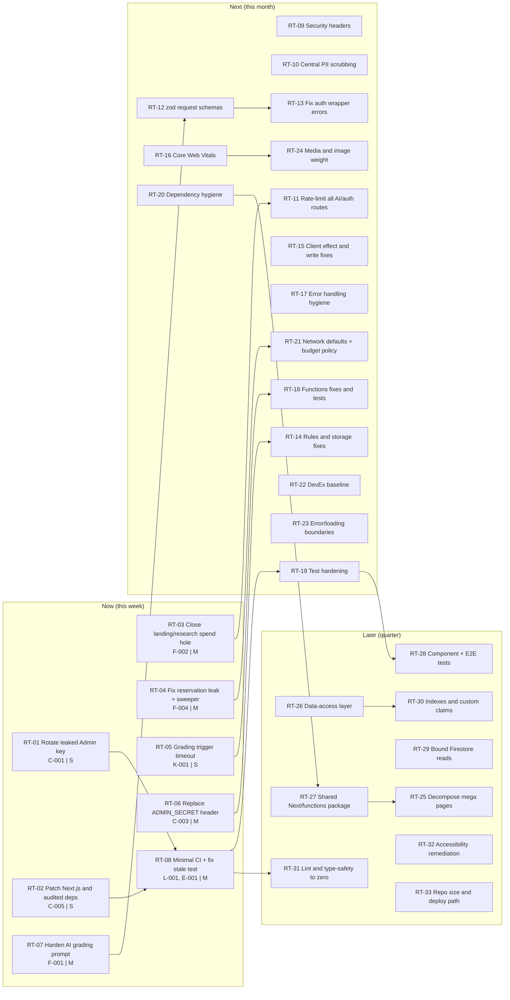

# Scorpio Code Quality Audit: Summary

**Date:** 2026-11-11 | **Repo:** `scorpio` (main @ `8b0c864`) | **Method:** Phase 0 baseline, 13 parallel workstreams (A-M), Phase 2 synthesis with independent re-verification of every Critical/High finding.
**Scope rule:** read-only audit. No application code or config was changed; `.env.local` values were never read or quoted; no production service was called.

## 1. Executive summary

**Overall score: 2.7 / 5, grade C** (weighted across 13 workstreams; scale in 1.2). The codebase is a capable, fast-moving product with a genuinely thoughtful core (strict TypeScript, default-deny Firestore rules with answer keys split out, transactional AI budget reservations, a layered Socratic prompt design) sitting on an unguarded delivery pipeline. There is **no CI at all**, so a red security test, 246 ESLint errors and an unpatched Next.js have all shipped unnoticed.

After de-duplication and verification there are **132 findings: 1 Critical, 7 High, 78 Medium, 35 Low, 11 Info.** The raw workstream output (151) was inflated: 19 rows were duplicates and 16 of the 28 Critical/High findings were downgraded when the cited code was re-opened (section 3). Among the verified Critical/High items, none is a confirmed cross-tenant data leak or student/teacher authz bypass.

**What matters most**
1. **Secrets and supply chain.** A Firebase Admin private-key literal was committed in `dea0862` and removed about 38 minutes later in `65737a2`; it is still in pushed history. Rotation cannot be verified from the repo. `next@16.2.1` is inside an npm-audit range that includes unauthenticated RCE advisories (reachability per advisory not confirmed).
2. **AI cost and integrity.** The public landing chatbot and research route are exempt from budget enforcement and fail open, and the per-visitor cap is client-controlled. Budget reservations leak on provider timeouts and nothing ever expires them. AI grading interpolates student text straight into the prompt.
3. **No safety net.** No CI, 46.9% line coverage on only 17 instrumented files, a 23.8% mutation score on the three libraries tested, zero Cloud Functions tests, and a known-failing emulator suite.
4. **Reliability gaps.** Grading triggers use the default function timeout against sequential AI calls; the shared admin secret guards all-tenant reads with no throttling.
5. **User-visible performance.** Mobile LCP is 10.0 s on `/login` and 5.4 s on `/`; 21 app routes ship 545-660 KB gz of first-load JS because layouts statically bundle the chatbot and KaTeX.

**Recommended first week:** rotate the key, bump Next.js and the audited packages, close the landing/research spend hole, fix reservation leaks, set grading-trigger timeouts, add minimal CI. These are 8 tickets, 3 of them effort S (see `remediation-tickets.md`).

### 1.1 Scorecard

Score is the workstream report's rounded 1-5 value, with the unrounded value in brackets (used for the weighted total). Counts are **post-verification and post-dedupe**; a merged finding is counted once under its primary's workstream.

| WS | Area | Score | Weight | Crit | High | Med | Low | Info | Main drivers |
|---|---|---|---|---:|---:|---:|---:|---:|---|
| A | Static analysis | 3 (2.5) | 5% | 0 | 0 | 5 | 3 | 0 | 441 ESLint problems (246 errors); 131 type-safety suppressions; 79 over-complex functions |
| B | Architecture | 3 (3) | 7% | 0 | 0 | 4 | 4 | 2 | No cycles, clean client/server boundary; but mega-pages, no data layer, policy logic duplicated |
| C | Security (app) | 3 (3) | 18% | 1 | 2 | 5 | 2 | 0 | Admin key in git history; vulnerable Next.js; shared admin secret; no security headers |
| D | Firebase rules / data | 3 (3.5) | 10% | 0 | 0 | 6 | 0 | 0 | Strong default-deny and tenant isolation; broken update paths, 11 missing indexes |
| E | Testing | 2 (2) | 10% | 0 | 0 | 10 | 3 | 2 | 46.9% line coverage on 17 files only; 23.8% mutation score; no CI; tautological tests |
| F | AI / LLM layer | 3 (2.5) | 10% | 0 | 3 | 4 | 0 | 0 | Grading prompt injection; landing/research budget fail-open; leaked reservations |
| G | API routes | 3 (3) | 10% | 0 | 0 | 6 | 2 | 0 | No schema validation; wrapper masks errors as 400; mass assignment on assignments |
| H | Frontend / React | 3 (3) | 5% | 0 | 0 | 6 | 4 | 2 | Listener/effect leaks; Compiler lint violations; most pages are client monoliths |
| I | Performance / bundle | 2 (2) | 5% | 0 | 0 | 12 | 4 | 2 | 10.0 s mobile LCP on /login; 545-660 KB gz first-load JS; 103 MB public/ |
| J | Dependencies | 2 (2) | 5% | 0 | 0 | 4 | 1 | 0 | 97 + 48 audit findings; unused CLI and duplicate packages in runtime deps |
| K | Cloud Functions | 3 (2.5) | 7% | 0 | 1 | 5 | 2 | 0 | No timeouts or tests; duplicated scrub/grading logic; swallowed errors |
| L | DevEx / docs / hygiene | 2 (2) | 4% | 0 | 1 | 6 | 5 | 1 | No CI/CD; 257 MB repo; README and .env.example drift |
| M | Accessibility / UI | 3 (3) | 4% | 0 | 0 | 5 | 5 | 2 | autoFocus overuse, unlabeled controls, clickable divs, destructive-button contrast |
| **All** | | **2.70** | 100% | **1** | **7** | **78** | **35** | **11** | **132 findings** |

### 1.2 Scoring method

Weights favour the areas where a defect harms students, teachers or the bill: Security 18%, Firebase rules 10%, AI layer 10%, API routes 10%, Testing 10%, Architecture 7%, Cloud Functions 7%, then 5% for A, H, I, J and 4% for L, M. Weighted score = sum(raw score x weight) = **2.70**. Grade scale: 4.5+ A, 4.0-4.49 B+, 3.5-3.99 B, 3.0-3.49 C+, **2.5-2.99 C**, 2.0-2.49 D, below 2 F. If the leaked key turns out to be unrotated, treat the grade as C-.

## 2. Top 10 risks

Ranked by severity weight (Critical 5, High 4, Medium 3) x likelihood (1-5, judged from exposure and ease of triggering). "Verified" means the cited lines were re-opened in Phase 2.

| # | Risk | Finding | Sev | Lik. | Score | Evidence (file:line) |
|---:|---|---|---|---:|---:|---|
| 1 | Firebase Admin private key committed to git history (still on `origin/main`); full read/write to production Firebase if unrotated | C-001 | Critical | 4 | 20 | [src/lib/firebase-admin.ts:L12-L42](../../src/lib/firebase-admin.ts#L12-L42) (history: `dea0862` adds, `65737a2` removes) |
| 2 | `next@16.2.1` inside npm-audit critical range (RCE, middleware bypass, SSRF, DoS advisories) on an internet-facing app | C-005 | High | 4 | 16 | [package.json:L67](../../package.json#L67), `raw/npm-audit.json` |
| 3 | Public landing chatbot and research route fail open on budget; client-chosen `visitorId` and spoofable `x-forwarded-for` allow unmetered Gemini spend | F-002 | High | 4 | 16 | [src/lib/ai/config.ts:L47-L62](../../src/lib/ai/config.ts#L47-L62), [src/app/api/chat/landing/route.ts:L63-L89](../../src/app/api/chat/landing/route.ts#L63-L89), [src/lib/rate-limit.ts:L21-L23](../../src/lib/rate-limit.ts#L21-L23) |
| 4 | Budget reservations never settled on timeout/transport error and never expired; orgs get locked out of AI | F-004 | High | 4 | 16 | [src/lib/ai/config.ts:L55-L85](../../src/lib/ai/config.ts#L55-L85), [functions/src/metering.ts:L20-L44](../../functions/src/metering.ts#L20-L44) |
| 5 | No CI/CD: nothing gates deploys (red test, 246 lint errors and vulnerable deps shipped) | L-001 | High | 4 | 16 | `.github/` (templates only), [package.json:L5-L11](../../package.json#L5-L11) |
| 6 | `/login` mobile LCP 10.0 s (auth spinner gate plus opacity-0 wrapper); `/` 5.4 s | I-020, I-021 | Medium | 5 | 15 | [src/app/login/page.tsx:L102-L104](../../src/app/login/page.tsx#L102-L104), [src/components/loading-screen.tsx:L31-L44](../../src/components/loading-screen.tsx#L31-L44) |
| 7 | Single shared `ADMIN_SECRET` header gates all-tenant reads (users, submissions, tutor chats) and invite codes; non-constant-time compare, no throttle or audit trail | C-003 | High | 3 | 12 | [src/app/api/admin/firestore/route.ts:L5-L33](../../src/app/api/admin/firestore/route.ts#L5-L33) |
| 8 | AI grading prompt interpolates student answer unescaped; a student can try to self-award marks; output not schema-validated | F-001 | High | 3 | 12 | [src/lib/ai/grading.ts:L21-L58](../../src/lib/ai/grading.ts#L21-L58), [src/lib/ai/grading.ts:L86-L107](../../src/lib/ai/grading.ts#L86-L107) |
| 9 | Grading Cloud Function triggers run on default timeout with sequential AI calls and a 15 min lease; submissions can stick in `submitted` | K-001 | High | 3 | 12 | [functions/src/grading.ts:L233-L247](../../functions/src/grading.ts#L233-L247), [functions/src/grading.ts:L308-L346](../../functions/src/grading.ts#L308-L346) |
| 10 | Student PII reaches Gemini unscrubbed on 6 of 10 AI routes; student emails logged in plaintext by functions | C-008 | Medium | 4 | 12 | [src/lib/ai/config.ts:L14-L72](../../src/lib/ai/config.ts#L14-L72), [functions/src/index.ts:L52-L114](../../functions/src/index.ts#L52-L114) |

Next in line (score 12 or less): C-007 (no security headers), C-002 (rate limits on 25 of 29 routes), E-016 (auth wrapper 21.85% mutation score), D-001/D-002 (client writes the rules reject).

## 3. Phase 2 verification of Critical and High findings (S2)

All 28 Critical/High findings from the workstreams were re-opened at the cited lines. **8 confirmed (1 Critical, 7 High), 16 downgraded, 4 removed as duplicates of a surviving finding.** Four Medium/Low/Info findings with non-specific locations were also anchored to exact lines, and one Low claim was corrected (B-006).

| ID | Reported | Verified | Outcome | What the code shows |
|---|---|---|---|---|
| C-001 | Critical | **Critical** | Confirmed | `git show dea0862` adds the key literal at line 44 of `src/lib/firebase-admin.ts`; `65737a2` ("fix: firebase private key leak") removes it (about 38 minutes later). HEAD reads `process.env` only ([src/lib/firebase-admin.ts:L19-L23](../../src/lib/firebase-admin.ts#L19-L23)). Both commits are reachable from `origin/main`. Rotation status is unknowable from the repo. |
| C-005 | High | **High** | Confirmed | Installed `next` is 16.2.1; `raw/npm-audit.json` marks range 9.3.4-canary.0 - 16.4.0 critical, with RCE advisories (image optimizer, `next/og`, `use cache`, Windows hosts). Reachability of each is not confirmed, so High, but treat as potentially Critical until upgraded. |
| C-003 | High | **High** | Confirmed | [src/app/api/admin/firestore/route.ts:L30-L33](../../src/app/api/admin/firestore/route.ts#L30-L33): plain `!==` against `ADMIN_SECRET`. `ALLOWED_COLLECTIONS` (L5-L19) includes `users`, `submissions`, `tutor_sessions`. Same header guards `teacher-code`, `request-access`, `research/respond`. No throttle or audit log. |
| F-001 | High | **High** | Confirmed (confidence Medium) | [src/lib/ai/grading.ts:L25-L30](../../src/lib/ai/grading.ts#L25-L30) embeds the answer inside quotes with no escaping or injection guard; JSON output is parsed without a schema (L86-L107). Exploitability depends on model behaviour, which was not tested. |
| F-002 | High | **High** | Confirmed | [src/lib/ai/config.ts:L48](../../src/lib/ai/config.ts#L48) exempts `landing`/`research`; L59-L60 swallow reservation errors for them; `visitorId` is any 1-128 char string ([src/app/api/chat/landing/route.ts:L65](../../src/app/api/chat/landing/route.ts#L65)), so fresh ids reset the 10-message cap (L84). |
| F-004 | High | **High** | Confirmed | `fetch` at [src/lib/ai/config.ts:L64-L72](../../src/lib/ai/config.ts#L64-L72) sits after `reserveBudget` (L56) with no `try/finally`; L81 throws without settling. `ai_reservations` is referenced only in `metering.ts` (no sweeper). Worst case about 10.6 cents per leaked reservation against the 50 cent free cap ([functions/src/metering.ts:L30](../../functions/src/metering.ts#L30)). |
| K-001 | High | **High** | Confirmed | No `timeoutSeconds` anywhere; `setGlobalOptions({ maxInstances: 10 })` only ([functions/src/index.ts:L17](../../functions/src/index.ts#L17)). Sequential per-answer calls at [functions/src/grading.ts:L233-L247](../../functions/src/grading.ts#L233-L247). On platform timeout the `catch` at L321 never runs. The 60 s default is from Firebase v2 docs, not measured. |
| L-001 | High | **High** | Confirmed | `.github/` holds `ISSUE_TEMPLATE/` and `PULL_REQUEST_TEMPLATE.md`; no `workflows/`. Kept at High as a deliberate exception to the strict rubric: it is the missing control behind D-004/E-001, A-001 and C-005. |
| A-001 | High | Medium | Downgraded | Claimed TDZ crash is false: [src/components/landing/workspace-preview-pages.tsx:L1642](../../src/components/landing/workspace-preview-pages.tsx#L1642) is inside an effect callback that runs after `useState` at L1654. H-007 was right. The lint gate failing (246 errors, 195 warnings) is true and stays as Medium. |
| J-001 | High | Medium | Downgraded | [package.json:L60](../../package.json#L60), L84, L90 list `firebase-functions`, `sib-api-v3-sdk`, `vercel` under `dependencies`; none is imported in `src/`, `functions/src` or `scripts`. Install-surface and size issue, not a runtime exploit. Absorbs I-011. |
| J-002 | High | n/a | Merged | Duplicate of C-005. |
| C-002 | High | Medium | Downgraded | Limiter trusts raw `x-forwarded-for` ([src/lib/rate-limit.ts:L21-L23](../../src/lib/rate-limit.ts#L21-L23)); only 4 of 29 routes call `checkRateLimit`. But the limiter is Firestore-backed, and authenticated AI cost is capped by transactional reservations. The uncapped-spend case is the landing route, tracked as F-002. Absorbs F-009. |
| C-004 | High | n/a | Merged | Duplicate of G-001. |
| G-001 | High | Medium | Downgraded | [src/app/api/assignments/route.ts:L18](../../src/app/api/assignments/route.ts#L18) does spread `...data`, but L9-L13 validate shape and course ownership, `splitAssignmentQuestions` validates id/text/points, and L18-L20 overwrite `teacherId`, `organizationId`, `questions`, `rubric`, `createdAt`. Teacher-only. The "`validateAssignmentQuestions`" named in the report does not exist; the client-only check is `validateQuestionAnswers` ([src/app/teacher/create/page.tsx:L492](../../src/app/teacher/create/page.tsx#L492)). |
| D-001 | High | Medium | Downgraded, location fixed | L115 is a read. The rejected write is [src/app/student/notebook/page.tsx:L421-L427](../../src/app/student/notebook/page.tsx#L421-L427) (`aiUsageCount` is not in the allowed keys at [firestore.rules:L31-L35](../../firestore.rules#L31-L35)). Effect: an error toast after each Copilot answer and a stale counter; server enforces usage separately. |
| D-002 | High | Medium | Downgraded | [firestore.rules:L43-L48](../../firestore.rules#L43-L48) has read/delete only. The single client update site is [src/app/teacher/assignments/page.tsx:L130](../../src/app/teacher/assignments/page.tsx#L130) (visibility toggle); it fails closed and logs only. No other edit write path exists. |
| D-003 | High | Medium | Downgraded | [firestore.rules:L76-L85](../../firestore.rules#L76-L85) allow arbitrary ids and unbounded size, and `id == uid` reads. Squatting only gives the victim access to the squatter's document; no read of victim data. Authenticated storage-bloat abuse. |
| D-004 | High | n/a | Merged | Duplicate of E-001 (same failing test). |
| F-003 | High | Medium | Downgraded | [src/lib/ai/tutor.ts:L62-L68](../../src/lib/ai/tutor.ts#L62-L68) returns `Error: <message>` as chat text with HTTP 200; `synthesizeRubric` returns a fixed "Failed to synthesize" string ([src/lib/ai/grading.ts:L161-L163](../../src/lib/ai/grading.ts#L161-L163)). Visible to the user, not silent corruption; leaks an internal message to students. |
| F-005 | High | Medium | Downgraded | `chatHistory`/`mode` are client-supplied ([src/app/api/student/tutor/route.ts:L10](../../src/app/api/student/tutor/route.ts#L10)) but identity is enforced ([src/lib/auth-verify.ts:L42-L44](../../src/lib/auth-verify.ts#L42-L44)), history is PII-scrubbed and role-labelled ([src/lib/ai/tutor.ts:L10-L30](../../src/lib/ai/tutor.ts#L10-L30)). Affects only the caller's own session. |
| F-007 | High | n/a | Merged | Duplicate of E-001 (stale test); hardcoded model name stays under B-009. |
| E-001 | High | Medium | Downgraded | [tests/security/workflows.test.ts:L60](../../tests/security/workflows.test.ts#L60) expects 0.28; at the rates in [functions/src/metering.ts:L7-L12](../../functions/src/metering.ts#L7-L12), 1000 in + 1000 out = 0.075 + 0.375 = 0.45, exactly what the run received. Production is right, the assertion is stale. Absorbs D-004, F-007. |
| G-002 | High | Low | Downgraded | `identityField: "userId"` makes [src/lib/auth-verify.ts:L42-L44](../../src/lib/auth-verify.ts#L42-L44) reject any body whose `userId` differs from the token uid, on both routes. `role`/`userRole` only picks a nav-hint list ([src/app/api/chat/route.ts:L58](../../src/app/api/chat/route.ts#L58)) or a student-only gate. No escalation. |
| G-003 | High | Medium | Downgraded | [src/app/api/teacher/network/membership/route.ts:L17](../../src/app/api/teacher/network/membership/route.ts#L17) creates `subscriptionStatus: 'none'`, `aiBudgetLimit: 0`, unlike [src/app/api/auth/register/route.ts:L39](../../src/app/api/auth/register/route.ts#L39) (active, 50). Fails closed, and the notebook UI has a dedicated "none" state ([src/app/student/notebook/page.tsx:L690](../../src/app/student/notebook/page.tsx#L690)), so partly intentional. Inconsistent, not exploitable. |
| G-004 | High | Medium | Downgraded | [src/lib/auth-verify.ts:L39-L41](../../src/lib/auth-verify.ts#L39-L41): `JSON.parse("")` throws and the catch at L98-L100 returns 400; handler exceptions thrown inside `execute()` are also reported as 400. Wrong status and lost diagnostics, no security impact. |
| K-002 | High | Medium | Downgraded | [functions/src/index.ts:L72](../../functions/src/index.ts#L72) defaults emails to disabled (`?? true`); recipients are all of the teacher's students with no course filter (L80-L83); no idempotency marker, but no `retry` either. Opt-in blast radius. |
| E-005 | High | Medium | Downgraded | `functions/` has no test files. Rubric: missing tests on critical logic is Medium. |
| I-020 | High | Medium | Downgraded | [src/app/login/page.tsx:L102-L104](../../src/app/login/page.tsx#L102-L104) confirmed; `raw/lighthouse-login-mobile.json`: score 73, LCP 10.0 s (simulated mobile). Severe UX, but rubric treats performance as Medium. Ranked #6 in the top 10. |

Other corrections found while verifying: **B-006** said `server-only` is used in 1 of 8 server modules; it is used in **0** (only comments match). **H-013, M-011, B-011, H-016** had directory-level locations and now point at exact files and lines.

Findings below High (Medium/Low/Info) were de-duplicated but not independently re-opened. Treat their evidence as workstream-reported.

### 3.1 De-duplication map (S1)

`findings.csv` was rebuilt from the 13 `findings-*.csv` files (151 rows) into 132 rows. The primary keeps the most detailed entry and lists the merged IDs in its title as `(also ...)`.

| Primary | Merged in | Primary | Merged in |
|---|---|---|---|
| G-001 | C-004 | J-001 | I-011 |
| C-005 | J-002 | J-004 | I-008 |
| C-002 | F-009 | A-006 | F-010 |
| E-001 | D-004, F-007 | K-004 | B-004 |
| J-003 | H-009, I-009 | B-001 | H-008 |
| A-005 | B-007 | A-001 | H-007 |
| I-014 | H-014 | L-001 | E-010 |
| J-005 | E-011 | C-009 | G-007 |
| I-006 | I-022 | | |

Related-but-kept pairs carry cross-references too (for example F-002 with C-002, B-009 with E-001, L-007 with I-001, F-008 with G-004).

## 4. Quick wins (effort S, severity Medium or higher)

48 findings. Fix text is the first sentence of each finding's recommendation in `findings.csv`.

| ID | Sev | Location | Fix |
|---|---|---|---|
| C-001 | Critical | [src/lib/firebase-admin.ts:L12-L42](../../src/lib/firebase-admin.ts#L12-L42) | Immediately delete/revoke service account key 0fb14b518c229ed6e15e7f128ad8e4e6e6e8dd82 in Google Cloud Console -> IAM & Admin -> Service Accounts and purge commit... |
| C-005 | High | [package.json:L49-L91](../../package.json#L49-L91) | Upgrade next to ^16.4.6, @tiptap/* to >=3.30.5 (with prosemirror-view >=1.42.3), protobufjs to >=7.6.5, and remove unused root vercel and sib-api-v3-sdk packages. |
| K-001 | High | [functions/src/grading.ts:L308-L346](../../functions/src/grading.ts#L308-L346) | Set timeoutSeconds: 300 and memory: '512MiB' on the grading triggers and grade questions with bounded concurrency and per-call timeouts. |
| C-006 | Medium | [src/app/api/auth/session/route.ts:L24-L27](../../src/app/api/auth/session/route.ts#L24-L27) | Verify the Origin header on POST/DELETE /api/auth/session and call adminAuth.verifySessionCookie followed by adminAuth.revokeRefreshTokens(decodedClaims.sub) on logout. |
| C-007 | Medium | [next.config.mjs:L1-L10](../../next.config.mjs#L1-L10) | Add an async headers() configuration in next.config.mjs (and matching headers in firebase.json) setting X-Frame-Options: DENY, X-Content-Type-Options: nosniff,... |
| C-009 | Medium | [src/app/api/checkout/route.ts:L82-L89](../../src/app/api/checkout/route.ts#L82-L89) | Return generic client error messages while logging details server-side, remove err.stack from responses, and remove export const dynamic = 'force-dynamic' from... |
| D-001 | Medium | [src/app/student/notebook/page.tsx:L421-L427](../../src/app/student/notebook/page.tsx#L421-L427) | Delete the client-side updateDoc(doc(db, 'users', user.uid), { aiUsageCount: increment(1) }) call at L423-L425 and read userData.aiNotebookUsageCurrent at L115. |
| D-002 | Medium | [firestore.rules:L43-L48](../../firestore.rules#L43-L48) | Add allow update: if isSignedIn() && isOwner(resource.data.teacherId) && request.resource.data.teacherId == resource.data.teacherId; |
| D-005 | Medium | [firestore.rules:L31-L32](../../firestore.rules#L31-L32) | Require (!request.resource.data.diff(resource.data).affectedKeys().hasAny(['email']) \|\| request.resource.data.email == request.auth.token.email) in the /users/{id}... |
| D-006 | Medium | [storage.rules:L9-L14](../../storage.rules#L9-L14) | Add a dedicated /resources/{courseId}/{allPaths=**} match block in storage.rules allowing teacher owners to upload video/(mp4\|webm) up to a bounded size alongside PDFs,... |
| E-001 | Medium | [tests/security/workflows.test.ts:L54-L61](../../tests/security/workflows.test.ts#L54-L61) | Debug settleBudget with the failing inputs (reserve twice, settle twice with 1000/1000 tokens): decide if 0.45 is a double-settle bug or a stale expectation; |
| E-002 | Medium | [__tests__/due-date.test.ts:L2-L10](../../__tests__/due-date.test.ts#L2-L10) | Extract the production predicate into src/lib (or import the real server check in src/app/api/submissions/route.ts) and test that; |
| E-003 | Medium | [__tests__/waypoints-plan-limits.test.ts:L10-L23](../../__tests__/waypoints-plan-limits.test.ts#L10-L23) | Move the predicate to src/lib/plan-limits.ts, import it in both the page and the test; |
| E-004 | Medium | [tests/security/webhooks.test.ts:L6](../../tests/security/webhooks.test.ts#L6) | Add tests where validateEvent throws WebhookVerificationError and assert 403 and no Firestore writes; |
| E-008 | Medium | [src/lib/rate-limit.ts:L44-L73](../../src/lib/rate-limit.ts#L44-L73) | Add tests with jest.useFakeTimers: N+1th call blocked, window reset, per-key isolation, memory eviction. |
| E-016 | Medium | [src/lib/auth-verify.ts:L39-L99](../../src/lib/auth-verify.ts#L39-L99) | Add unit tests in __tests__/auth-verify.test.ts covering 500,000 vs 500,001 byte bodies (413), teacher positive path (200), submission/portfolio ownership allow/deny and... |
| F-003 | Medium | [src/lib/ai/tutor.ts:L62-L68](../../src/lib/ai/tutor.ts#L62-L68) | Re-throw errors in tutor.ts, synthesizeRubric, and getNavigationResponse so API routes return 4xx/5xx status codes, and never persist error strings into tutor_sessions... |
| F-006 | Medium | [src/lib/ai/grading.ts:L91-L107](../../src/lib/ai/grading.ts#L91-L107) | Validate all JSON model outputs with zod schemas, run string-score normalization before numeric checks, and remove the line-comment regex in assignment.ts:L151. |
| G-001 | Medium | [src/app/api/assignments/route.ts:L6-L24](../../src/app/api/assignments/route.ts#L6-L24) | Validate the POST payload with a strict zod schema whitelisting allowed fields, call validateAssignmentQuestions(data.questions) on the server, and validate dueDate... |
| G-003 | Medium | [src/app/api/teacher/network/membership/route.ts:L14-L18](../../src/app/api/teacher/network/membership/route.ts#L14-L18) | Use a shared helper to initialize new organization documents consistently across /api/auth/register and /api/teacher/network/membership. |
| G-006 | Medium | [src/app/api/support/report/route.ts:L50-L64](../../src/app/api/support/report/route.ts#L50-L64) | Return 500/503 when Firestore persistence fails, validate screenshot payloads, and populate user identity fields from the authenticated profile. |
| G-008 | Medium | [src/app/api/github/stats/route.ts:L3-L4](../../src/app/api/github/stats/route.ts#L3-L4) | Remove dynamic = 'force-dynamic' from github/stats, add fetch timeouts, export maxDuration on AI routes, and parallelize batch/question AI calls with bounded concurrency. |
| H-001 | Medium | [src/app/student/notebook/page.tsx:L150-L200](../../src/app/student/notebook/page.tsx#L150-L200) | Use a `cancelled` flag + collect unsubscribers in an array pushed synchronously; |
| H-002 | Medium | [src/app/student/assignment-view/page.tsx:L329-L359](../../src/app/student/assignment-view/page.tsx#L329-L359) | Keep `answers` in a ref (or useEffectEvent) and run one interval keyed on [timerActive]; |
| H-006 | Medium | [src/components/ui/sidebar.tsx:L609-L611](../../src/components/ui/sidebar.tsx#L609-L611) | Generate random values in useState initializer behind useEffect/useId-seeded PRNG; |
| H-013 | Medium | [src/app/student/layout.tsx:L1-L44](../../src/app/student/layout.tsx#L1-L44) | Add app/error.tsx, app/global-error.tsx, student/error.tsx, teacher/error.tsx (with reset + report) and loading.tsx skeletons for student/ and teacher/. |
| I-002 | Medium | [src/components/landing/system-demos.tsx:L51-L54](../../src/components/landing/system-demos.tsx#L51-L54) | Add `preload="none"` + `poster`, lazy-mount via IntersectionObserver, serve the compressed rendition. |
| I-004 | Medium | [src/app/(docs)/about/about-client.tsx:L229-L230](../../src/app/(docs)/about/about-client.tsx#L229-L230) | Resize/convert to WebP/AVIF (headshot <=150 KB, OG 1200x630 <=300 KB JPEG) and render with next/image. |
| I-007 | Medium | [next.config.mjs:L1-L8](../../next.config.mjs#L1-L8) | Set `outputFileTracingRoot: path.join(__dirname)` in next.config.mjs and remove the stray parent lockfile. |
| I-014 | Medium | [src/app/student/submissions/page.tsx:L36-L60](../../src/app/student/submissions/page.tsx#L36-L60) | Store assignmentTitle/courseId on the submission at write time (server-side) or cache assignments by id in a Map outside the listener; |
| I-018 | Medium | [src/app/student/layout.tsx:L5](../../src/app/student/layout.tsx#L5) | Wrap NavigationChatbot in next/dynamic(..., { ssr: false }) and defer loading MarkdownRenderer/KaTeX until the chat drawer is opened; |
| I-020 | Medium | [src/app/login/page.tsx:L102-L104](../../src/app/login/page.tsx#L102-L104) | Render the login Card immediately during SSR/initial paint instead of returning <LoadingSpinner fullPage /> while authLoading is true, and remove initial={{ opacity: 0... |
| I-021 | Medium | [src/components/loading-screen.tsx:L31-L44](../../src/components/loading-screen.tsx#L31-L44) | Remove the blocking #scorpio-intro modal splash (or do not gate the hero LCP element behind opacity:0 / animation-play-state:paused) and load the LandingChatbot chunk... |
| J-001 | Medium | [package.json:L59-L91](../../package.json#L59-L91) | Run 'npm uninstall vercel sib-api-v3-sdk firebase-functions' at the repository root and invoke the Vercel CLI via npx or CI runners. |
| J-003 | Medium | [package.json:L61-L66](../../package.json#L61-L66) | Consolidate all animation imports onto a single package (framer-motion or motion), standardize Radix imports, and uninstall the 11 redundant @tiptap/extension-* packages. |
| J-004 | Medium | [package.json:L15-L110](../../package.json#L15-L110) | Uninstall unused dependencies or wire up intended packages (@vercel/analytics, @vercel/speed-insights, zod validation schemas). |
| J-005 | Medium | [package.json:L108-L112](../../package.json#L108-L112) | Align eslint-config-next with next, synchronize shared dependency ranges across root and functions/package.json, and migrate Jest transform to next/jest or a... |
| K-003 | Medium | [functions/src/index.ts:L22-L36](../../functions/src/index.ts#L22-L36) | Delete associated Firebase Storage objects in submission.workFiles before deleting the submission documents, matching /api/teacher/students/cleanup. |
| K-005 | Medium | [functions/src/grading.ts:L308-L324](../../functions/src/grading.ts#L308-L324) | Log caught errors via firebase-functions/logger, pass the latest current doc to gradeSubmission, and redact student emails from logs. |
| L-002 | Medium | [firebase.json:L2-L24](../../firebase.json#L2-L24) | Document the single supported deploy path, add `.firebaserc` aliases (staging/prod), add predeploy `npm run test && tsc --noEmit`, and remove the Vercel artefacts if... |
| L-003 | Medium | [package.json:L5-L11](../../package.json#L5-L11) | Add prettier + eslint-config-prettier, husky + lint-staged (eslint --fix, prettier), `"typecheck": "tsc --noEmit"`, `engines.node: ">=22"` and .nvmrc. |
| L-004 | Medium | [README.md:L4](../../README.md#L4) | Rewrite Quick Start: prerequisites (Node 22, Java 17+, firebase-tools), `cp .env.example .env.local`, `npm ci`, `cd functions && npm ci`, emulator instructions, test... |
| L-005 | Medium | [src/app/api/checkout/route.ts:L37-L40](../../src/app/api/checkout/route.ts#L37-L40) | Add the missing names to .env.example with comments; |
| L-012 | Medium | [src/lib/firebase.ts:L62-L64](../../src/lib/firebase.ts#L62-L64) | Add an `emulators` block (auth, firestore, storage) to firebase.json, wire connectAuthEmulator/connectFirestoreEmulator/connectStorageEmulator in src/lib/firebase.ts... |
| M-001 | Medium | [src/components/math-builder-modal.tsx:L68-L259](../../src/components/math-builder-modal.tsx#L68-L259) | Keep one deliberate focus target per dialog (Radix Dialog already focuses first element); |
| M-002 | Medium | [src/components/landing/workspace-preview-pages.tsx:L873](../../src/components/landing/workspace-preview-pages.tsx#L873) | Add htmlFor/id pairs or wrap control in <label>; |
| M-003 | Medium | [src/components/calculator/scientific-calculator.tsx:L211](../../src/components/calculator/scientific-calculator.tsx#L211) | Use <button type="button"> (or role="button" tabIndex=0 + onKeyDown). |
| M-005 | Medium | [src/components/ui/button.tsx:L14](../../src/components/ui/button.tsx#L14) | Darken --destructive (light ~L0.55) and drop /60 in dark; |

## 5. Remediation roadmap

Full ticket text is in [remediation-tickets.md](remediation-tickets.md). IDs are `RT-nn`.

| Phase | Ticket | Title | Priority | Effort | Findings |
|---|---|---|---|---|---|
| **Now** | RT-01 | Rotate/revoke leaked Firebase Admin key | Critical | S | C-001 |
| | RT-02 | Patch Next.js and audited packages | High | S | C-005, J-002 |
| | RT-03 | Close landing/research AI spend fail-open | High | M | F-002 |
| | RT-04 | Settle or expire AI budget reservations | High | M | F-004 |
| | RT-05 | Explicit timeout and failure path for grading triggers | High | S | K-001, K-005 |
| | RT-06 | Replace shared `ADMIN_SECRET` header with admin-claim auth | High | M | C-003 |
| | RT-07 | Harden AI grading against prompt injection | High | M | F-001, F-006 |
| | RT-08 | Minimal CI and fix stale budget test | High | M | L-001, E-001 |
| **Next** | RT-09 | Add security headers | Medium | S | C-007 |
| | RT-10 | Centralise PII scrubbing and redact logs | Medium | M | C-008 |
| | RT-11 | Rate-limit all AI and auth routes with trusted IP | Medium | M | C-002 |
| | RT-12 | zod schemas for API request bodies | Medium | M | G-001, G-005 |
| | RT-13 | Fix `withAuthorizedRequest` error semantics | Medium | M | G-004, F-008 |
| | RT-14 | Firestore and Storage rules corrections | Medium | M | D-002, D-003, D-005, D-006 |
| | RT-15 | Client effect, listener and write fixes | Medium | M | D-001, H-001, H-002, H-003 |
| | RT-16 | Core Web Vitals: login, landing, providers, layouts | Medium | M | I-018, I-019, I-020, I-021 |
| | RT-17 | Error-handling hygiene (AI, API, functions) | Medium | M | F-003, G-006, C-009, K-005 |
| | RT-18 | Cloud Functions: email scoping, storage cleanup, tests | Medium | M | K-002, K-003, K-007, E-005 |
| | RT-19 | Test hardening on critical logic | Medium | M | E-002, E-003, E-004, E-006, E-007, E-008, E-016 |
| | RT-20 | Dependency hygiene | Medium | M | J-001, J-003, J-004, J-005 |
| | RT-21 | Network defaults and single budget policy | Medium | M | G-003, B-003 |
| | RT-22 | DevEx baseline (engines, typecheck, hooks, env, README, emulators) | Medium | M | L-003, L-004, L-005, L-012 |
| | RT-23 | Route error/loading boundaries | Medium | S | H-013 |
| | RT-24 | Media and image weight | Medium | M | I-001, I-002, I-004, I-006 |
| **Later** | RT-25 | Decompose mega pages, dedupe workspace preview | Medium | L | B-001, A-002, A-005 |
| | RT-26 | Data-access layer and collection constants | Medium | L | B-005 |
| | RT-27 | Shared package for metering, scrubbing, grading | Medium | L | B-002, K-004, B-009 |
| | RT-28 | Component and E2E tests | Medium | L | E-009 |
| | RT-29 | Bound Firestore reads and paginate | Medium | M | I-012, I-013, I-014, I-015 |
| | RT-30 | Indexes and custom claims | Medium | M | D-007 |
| | RT-31 | Lint and type safety to zero errors, stricter ESLint | Medium | L | A-001, A-003, A-004, A-008 |
| | RT-32 | Accessibility remediation | Medium | M | M-001 to M-005 |
| | RT-33 | Repository size and deploy path | Medium | M | L-007, L-002 |

## 6. Positives

- **Strict, clean type-checking.** `tsc --noEmit` passes with 0 errors in both root and `functions/` (`strict`, `noImplicitReturns`, `noUnusedLocals` in functions). Production build passes (72 pages).
- **Firestore rules are default-deny with real tenant isolation.** [firestore.rules:L98](../../firestore.rules#L98) makes every unlisted collection server-only. Answer keys live in `assignment_keys` ([firestore.rules:L49-L51](../../firestore.rules#L49-L51)); students cannot create or edit submissions from the client ([firestore.rules:L52-L58](../../firestore.rules#L52-L58)).
- **Emulator-backed rules and workflow tests.** `tests/security/` runs against the Firebase emulators: 33 of 34 tests pass, including end-to-end teacher/student flows and negative cases. Auth unit tests assert denial paths and fail closed (E-014).
- **Token handling is correct.** `verifyIdToken(..., true)` and `verifySessionCookie(..., true)` check revocation ([src/lib/auth-verify.ts:L10](../../src/lib/auth-verify.ts#L10), L16); identity is bound to the request body for 17 wrapped routes.
- **Transactional AI budget design.** `reserveBudget`/`settleBudget` use Firestore transactions with idempotent settlement and a concurrency test ([functions/src/metering.ts:L20-L64](../../functions/src/metering.ts#L20-L64)). The design is sound; the gaps are lifecycle (F-004) and exemptions (F-002).
- **Layered Socratic prompt design.** `CONSTRAINT_LEVELS` in `src/lib/ai/constants.ts` composes domain, pedagogical, notation and Socratic layers and supports ablation levels; the F report documents drift from `LAYERING.MD` worth fixing, not a missing design.
- **Rate limiter is Firestore-backed and fails closed**, not an in-memory map ([src/lib/rate-limit.ts:L19](../../src/lib/rate-limit.ts#L19)).
- **Architecture is tidy where it counts.** madge finds 0 circular dependencies; no `use client` file reaches a server module; React Compiler is enabled; heavy libraries (`react-globe.gl`, TipTap) are lazy-loaded.
- **Secrets hygiene mostly good.** `.env.local` is gitignored and was never committed; the only history leak is C-001.
- **Governance docs exist** (`SECURITY.md`, issue and PR templates), and the UIAUDIT "dark:bg-white" cleanup claim checked out (H-016).

## 7. Metrics baseline

Snapshot at 2026-11-11 for tracking. Sources are in `raw/`.

| Metric | Value | Source / note |
|---|---|---|
| Total LOC (code) | **52,401** (302 files); 55,698 raw lines in `src/` + `functions/src/` | `raw/cloc.json`, `00-baseline.md` |
| Unit test coverage (instrumented files only) | **46.9% lines**, 45.64% statements, 36.98% branches, 43.93% functions | `raw/jest.txt`; 17 files instrumented (P0 collected 13), so real coverage is lower |
| Static file coverage (fallow) | **14.3%** (215 untested files, 405 untested exports) | E report (fallow run) |
| Mutation score (3 libs) | **23.77%** (assignment-validation 88.0%, auth-verify 21.85%, usage-limit 0.0%) | Stryker, E report |
| Test suites | Jest 10/10 suites, 39/39 tests; security suites 3/4 suites, 33/34 tests | `00-baseline.md` |
| ESLint | **246 errors, 195 warnings** (441 problems; 13 auto-fixable) | `raw/eslint.json` |
| TypeScript errors | 0 (root), 0 (`functions/`) | `raw/tsc-*.txt` |
| `any` count | **104** explicit `any`, **24** `as any`, **3** `@ts-ignore` (131 suppressions, 55 in server/AI libs), 2 `eslint-disable` | `raw/smells.txt`, A-003 |
| Duplication, jscpd | **2.00%** of lines (1,121 lines, 64 clones; 2.38% of tokens) | `raw/jscpd-summary.txt` |
| Duplication, fallow | **8.7%** (4,866 lines, 148 clone groups, 71 files) | `raw/fallow-dupes.txt` |
| Largest file | **2,793 lines**, `src/components/landing/workspace-preview-pages.tsx` | `00-baseline.md` |
| Largest function | 1,444 lines; 79 functions over cyclomatic 15 (max 80); 73 over 150 lines | A-002 |
| Heaviest route (first-load JS) | `/student`: **659.5 KB gz** (2,141 KB parsed); 21 app routes at 545-660 KB gz; `/login` 411 KB, `/` 272 KB | I report, `raw/bundle-analyzer-*.json` |
| Largest JS chunk | 327,186 B (`3343-*.js`, recharts) | `raw/largest-chunks.txt` |
| Heaviest assets | `public/` **103 MB**; `public/demos/scorpio-demo.mp4` 22.5 MB; `headshot-sage.jpg` 3.1 MB | I-001, I-004 |
| Lighthouse mobile (LCP / score) | `/login` **10.0 s / 73**; `/` 5.4 s / 79; `/pricing` 1.2 s / 99 | `raw/lighthouse-*.json` |
| Dependency vulnerabilities | Root **97** (6 critical, 39 high); functions **48** (3 critical, 13 high) | `raw/audit-summary.txt` |
| Repo size / build | 257 MB repo; `next build` 53 s | L-007, `00-baseline.md` |
| Cloud Functions tests | 0 test files | K-007 |
| Findings (this audit) | 132: 1 Critical, 7 High, 78 Medium, 35 Low, 11 Info | `findings.csv` |

## 8. Caveats

- Not run: authenticated Lighthouse/axe on `/student` or `/teacher` (no emulator wiring, L-012); mutation testing covered 3 files only; full-history `gitleaks` was replaced by a git-log scan because the binary was unavailable.
- Whether the leaked key was revoked, whether `origin` is private, and per-advisory reachability of Next.js CVEs cannot be determined from the repo alone.
- Likelihood scores in section 2 are judgement calls; the verification table in section 3 is the evidence.
